# AGENTS.md — uDALES-Geo for agents and developers

This is the detailed guide to uDALES-Geo: what every stage does, in the order
the code runs it, with the exact rules, thresholds, checks and files; the
invariants a change must keep; how to verify a change; where to extend the
tool; and the known issues and open decisions. It is written for coding agents
and for anyone who has to fix or extend something.

- The short summary for users (setup, running, outputs) is
  [README.md](README.md). Project status is in
  [docs/PROGRESS.md](docs/PROGRESS.md). The former `docs/PIPELINE.md` and
  `docs/GUIDE.md` were merged into this file and the README and deleted
  (2026-10-05).
- State described: the code as of 2026-10-05, after the code-review fixes.
  Every default and threshold below was checked against the code on that
  date. If you change behaviour, update the matching stage here, the line in
  `configs/example.jsonc`, and a test.

Working rules for this repository:

1. The owner decides what code is removed. Candidates found by the 2026-09-29
   audit are listed in §7.4 as "pending decision"; do not delete them on your
   own initiative.
2. The owner prefers simple, readable code over clever code: one step per
   line, plain names, plain English messages and comments.
3. New config keys get their default in `build.DEFAULTS` (section
   `"buildings"`), in the `site.get(key, default)` call in `build_site` (top
   level), or in `vegetation.DEFAULTS` (section `"vegetation"`), plus one
   commented line in `configs/example.jsonc` (§4.8).
4. On the author's PC, run one heavy job at a time (§2.6).
5. The project is MIT licensed (`LICENSE`) and kept in git (GitHub, private,
   from 2026-10-05). It is meant to join the uDALES tools later; uDALES is
   GPL-3.0-or-later, which can take MIT code. `voxelize._cells_of` mirrors
   the cell rule of udprep's `load_stl` — tell the uDALES maintainers when
   merging. `sites/` is in `.gitignore` and is never committed.

---

## 1. What the tool does, and the repository map

uDALES-Geo turns two OpenStreetMap corner coordinates and a JSON-with-comments
config into uDALES inputs. It downloads OSM building footprints, gives each a
height (LiDAR where it can be downloaded, else the OSM tag, else a default),
fits the buildings to the uDALES grid (fills gaps and courtyards too narrow for
the grid, drops buildings the grid cannot see), meshes them into one
connected 2.5D surface (roofs, walls and ground, open only along the domain
edge), checks it with uDALES' own `udgeom` plus its own
gates, and writes `geom.<expnr>.stl`. Optionally it finds individual trees in
a canopy height map and writes uDALES vegetation files.

Run: `.venv\Scripts\python -m udales_geo configs\<file>.jsonc`

### Package `udales_geo/`

| module | role |
|---|---|
| `__init__.py` | version string (`0.1.0.dev0`) |
| `__main__.py` | command line: config path, `--force-fetch`, `--redo-trees`; a `ConfigError` exits with code 2 |
| `build.py` | the pipeline driver `build_site`, `DEFAULTS` for the `buildings` section, grid suggestion, `overview.png`, `site.report.json` |
| `common.py` | `load_jsonc`, `resolve_udales_tools`, `Config`/`Grid` dataclasses, `world_to_sim_polygon`, `ConfigError`, `write_report`; legacy `load_config` |
| `region.py` | corners → projected domain box (`make_region`), `on_lattice`, `region_from_bbox`, `auto_utm` |
| `osm.py` | Overpass download, relation ring assembly, courtyards to their outer ring, OSM height parsing, GeoJSON in the site CRS |
| `edges.py` | `edge_buildings: "extend"`: keep edge buildings whole and grow the domain |
| `tile.py` | `tile: [nx, ny]`: copies of the periodic tile after the heights (stage 8b) |
| `footprints.py` | load, clip, split and filter footprints (`load_footprints`); legacy CRS detection and non-GeoJSON readers |
| `surface.py` | LiDAR nDSM for building heights: your DSM/DTM files, your point-cloud tiles, or the shared downloader |
| `rasters.py` | shared LiDAR downloader: `SOURCES` table (England, Netherlands, Flanders, France, Canada, Switzerland, United States), tiling, caching, validation; STAC sources; `fetch_surfaces` |
| `pointclouds.py` | point clouds to rasters on the site grid: USGS 3DEP (Entwine Point Tiles, The National Map tiles, z unit checked against the 3DEP DEM) and your own LAS/LAZ tiles; DSM, DTM and the building-class surface |
| `heights.py` | one height per footprint (`assign_heights`): LiDAR percentile, OSM attribute, default; `assign_heights_two_surfaces`: building-class surface first, all-surface with a median fallback; legacy LAS route |
| `buildings.py` | `build_buildings`: footprints → heights → clean-up → gap filling → grid fit → mesh → checks → `buildings.stl` and reports; legacy extrude route |
| `gaps.py` | sub-grid gap filling (`fill_gaps`), `thread_through_fills`, `node_together` (both with `SNAP_TOL`), `remaining_narrow_area` |
| `grid_fit.py` | uDALES issue #367 detection on the c-grid (`IBM_TOL` solid rule, labelling shared with `case_check`), courtyard filling, unseen buildings, centre plugs, census |
| `city_surface.py` | the mesher: snap-rounded planar partition → triangulated roofs and ground + walls; corner-contact classifier |
| `canopy.py` | canopy height map (CHM) sources: your GeoTIFF, LAS + DTM, England EA VOM, Meta/WRI global; `SiteRaster`, `_warp_into` |
| `trees.py` | CHM → crowns (watershed) → `trees.geojson` I/O → tree solids |
| `vegetation.py` | vegetation stage driver, `DEFAULTS` for the `vegetation` section |
| `voxelize.py` | tree solids → grid cells (udprep-identical or exact), veg file writers, udprep cross-check |
| `case_check.py` | standalone, after udprep: #367 check on `solid_c.txt` (periodic per `BCxm`/`BCym`), unused facets, missing-flux lines from the case's logs; also holds `periodic_labels` and `level_components`, which `grid_fit.py` imports |
| `facet_types.py` | standalone backend, not wired in: ground/roof/wall per STL triangle and the types file udprep reads |

### Tests `tests/` (offline: no network, no uDALES clone; 204 cases)

| file | covers |
|---|---|
| `test_edges.py` | extend policy (growth, clearance, min_inside, limits, bad mode); LiDAR roof percentile vs eaves |
| `test_tile.py` | copies of the tile: translation, domain and grid growth, the `tile` key |
| `test_pointclouds.py` | points to rasters (DSM highest return, DTM mean ground, building surface, noise left out), the EPT octree walk on a fake hierarchy, The National Map project ranking, the z-unit check, the local-tiles route end to end on a synthetic LAZ + DEM (building surface, tiles_crs, tiles that miss the site) |
| `test_heights_two_surfaces.py` | the two-surface rule: building surface first, a shed under a tree takes the median, the median by default for a point cloud without building class (off with `lidar_spread_fallback_m` null), never for raster sources unless asked; an open lot under trees (median below `min_height`) takes its OSM height or is left out, not the crown; counters, LiDAR − OSM over both passes |
| `test_osm_heights.py` | relation courtyards to the smallest containing outer (nested buildings); LiDAR-flat rule |
| `test_osm.py` | height-tag parsing (finite, positive metres only), `building=no` left out, a courtyard ring that is a building kept, an incomplete Overpass answer refused |
| `test_config.py` | null = default, `expnr` 0–999, error line numbers after block comments, corner order, antimeridian, the vegetation switch, grid spacing when xlen is not a multiple of dx |
| `test_rasters.py` | DTM hole filling; request boxes on each source's pixel grid; request URLs per service kind; the new sources picked by location, STAC plans; a certificate failure not retried, a reset retried |
| `test_gaps.py` | gap filling widths, heights, notches, domain edge, snap grid; mesher micro-face regression; per-piece opening; per-level sliver claim and noding that never swaps corners (both meshed and checked with `_hair_cracks`) |
| `test_gaps_tips.py` | wedge tips (filled up to where a W-disc touches both walls; 60-90 deg corners not), tip height (lower of the two walls, not the lowest building nearby; a corner touch does not count; a short contact counts if it is a quarter of the outline; a sliver touching a building at one end takes no height from it; a part lined by a short building contact and a fill takes a fill height, by one short contact only the lowest neighbouring height; with the footprints' 1 cm precision model), pockets (between two tips, with the tip fills as walls; closed by a low kiosk; one that no level claims takes the lowest neighbouring height; a thin pocket part is not claimed where it hangs free), tips found in a later round (take the tip height; lined by a building and a lower fill, the fill's height; lined by two buildings, no height from fills; no heights from each other; a pocket fill less than half in one keeps its claim), slivers next to a taller tip (not raised to a speck, to a fill under 2 cm wide, on a touch at one end or on a touch under 5 snap steps), thin parts (with and without a grid point, a c point only, at an upper level, attached to claimed fills as a left-over or at its level, not counted as remaining), tip hull overreach (three random wedges, a rotated wedge, a pinch), a tip at the domain edge left open, overlapping mitre spikes and a near-degenerate opening that crashed the build |
| `test_grid_fit.py` | courtyard detection and filling (outline and cell routes, heights, sheds, towers, roof-height solid rule, wide courtyard behind an unresolved slit), unseen buildings, plugs only where enclosed and without cracks, separate dy, `on_lattice` rounding like GEOS |
| `test_case_check.py` | cavity detection on synthetic IBM masks: x and y seams, wrap-padded block test, non-periodic boundaries; a `solid_c.txt` from another grid is exit code 2 |
| `test_facet_types.py` | classes per triangle, the types file format and its line order (line n = triangle n) |
| `test_vegetation.py` | quadkeys, LAS CHM, segmentation, tree shapes, voxelization methods, crowns cut around buildings (cut, low roof, split crown, non-convex cells, nothing left, shared corner stays watertight after an STL round trip), building drops, file formats, `trees.geojson` and `trees_plan.geojson` I/O |

### Configs `configs/`

| file | purpose |
|---|---|
| `example.jsonc` | West Village, Manhattan since 2026-10-11 (OSM heights, Meta canopy map; South Kensington before); documents every parameter. It uses the owner's own choices `edge_buildings "extend"`, `snap_m 2.0`, `shape "box"` and `voxel_method "exact"` (keep them); the code defaults are `"clip"`, 1.0, `"box"` and `"udprep"` |
| `compare_heights_osm.jsonc` / `compare_heights_lidar.jsonc` | South Kensington twins, expnr 101/102: only `height_source` differs (`"osm"` / `"lidar"`); `zsize` 264 in both |
| `compare_gaps_open.jsonc` / `compare_gaps_filled.jsonc` | Earl's Court terraces twins, expnr 202/201: only `fill_gaps` differs (false / true); `zsize` 96 in both |

All five set `snap_m = dx = 2`, `edge_buildings "extend"`, vegetation on, and
`udales_tools` to `F:/stl/u-dales/tools/python` (change it on another machine).
The four `compare_*` sites are in London (LiDAR heights, EA canopy map).

### Docs `docs/`

`gap_filling_design.md` (why sub-grid gaps break uDALES, with uDALES source
references; §9 is the as-built state of 2026-09-28; later changes —
per-piece opening, threading and the per-level claim — are in stage 10 here,
final noding in stage 11f; §10 is the wedge-tip fix of 2026-10-11: tips,
tip heights, pockets, thin parts), `vegetation_design.md`,
`building_height_sources.md` (LiDAR services by country, endpoints, probes,
candidate downloaders), `PROGRESS.md` (status).

### Tools `tools/`

`tools/udprep_check/` (`README.md`, `make_case.py`, `run_udprep.py`): runs
uDALES' own udprep on a built site to check the geometry (§5.3). It is not
part of the package or the offline tests; `run_udprep.py` needs its own
Python environment for udprep plus gfortran (see its README).

### Other

`requirements.txt` (numpy, scipy, shapely ≥ 2.1, pyproj, trimesh,
mapbox-earcut, matplotlib, triangle, rasterio, scikit-image, laspy[lazrs],
xarray, pandas, pytest). `sites/<name>/` holds every run's output (not in the
repository). The venv on the author's PC is Python 3.13.

---

## 2. Running and testing

### 2.1 Setup

```bat
python -m venv .venv
.venv\Scripts\pip install -r requirements.txt
```

The tool needs a clone of current uDALES master for its `tools/python`
folder: `udgeom` (geometry checks, every run) and `udprep` (vegetation
cross-check). Code comments refer to uDALES master commit 2fe4df1. Point to
it with `"udales_tools"` in the config (relative to the config's folder) or
the `UDALES_TOOLS` environment variable; the first that exists is used, and
the run stops with a `ConfigError` before any download if neither does. Only
the folder's existence is checked, not that `udgeom` imports.

### 2.2 Run a site

```bat
.venv\Scripts\python -m udales_geo configs\example.jsonc
.venv\Scripts\python -m udales_geo configs\example.jsonc --redo-trees
.venv\Scripts\python -m udales_geo configs\example.jsonc --force-fetch
```

- `--redo-trees`: rebuild `chm.tif` and `trees.geojson` (overwritten without
  a backup); the OSM download is reused.
- `--force-fetch`: download the OSM buildings again (overwrites
  `buildings_osm.geojson` without a backup) and rebuild the trees as
  `--redo-trees` does. LiDAR and canopy tiles in `cache/` are still reused.
- Exit codes: a `ConfigError` prints "Config problem in …" and exits with 2;
  any other error prints a Python traceback. The last lines of a successful
  run are `=== <name>: DONE ===` and a summary.
- Progress is printed with stage prefixes: `[region]`, `[osm]`, `[build]`,
  `[edges]`, `[lidar]`, `[heights]`, `[footprints]`, `[buildings]`, `[gaps]`,
  `[grid]`, `[surface]`, `[vegetation]`, `[canopy]`, `[trees]`, `[report]`.

### 2.3 Offline tests

```bat
.venv\Scripts\python -m pytest tests -q
```

169 test cases (about 2 s), no network and no uDALES clone. The network sources
(Overpass, LiDAR services, EA VOM, Meta CHM), `udgeom` and the udprep
cross-check are exercised only by building real sites (§5.2).

### 2.4 Comparison configs

The two twins differ in exactly one setting (plus `name`/`expnr`), on the same
grid, so a uDALES run of each pair isolates that setting's effect. The
figures `sites/compare_gaps.png`, `sites/compare_heights.png` and
`sites/compare_summary.json` were made on 2026-09-29, before courtyard
filling existed; they are out of date and the scripts that made them are not
in the repository.

### 2.5 Standalone tools

```bat
.venv\Scripts\python -m udales_geo.case_check <case_dir>
.venv\Scripts\python -m udales_geo.facet_types sites\<name>\udales\geom.001.stl --out sites\<name>\udales\types.001.txt --ground -1 --roof 1 --wall 2
```

- `case_check` (§5.4) runs on a uDALES case folder after udprep. The folder
  name must be the expnr; it reads `namoptions.<expnr>` (itot, jtot, ktot;
  `BCxm`, `BCym`, default 1 = periodic), `solid_c.txt`, and if present
  `facets_unused.<expnr>` and the "Total area missing flux" lines of the
  folder's `*.log` files (e.g. `write_inputs.<expnr>.log`, which
  `write_inputs.sh` writes), falling back to `ibm_stdout.txt`. It needs only
  numpy and scipy, so the file can be copied to an HPC on its own. Exit code
  1 if narrow enclosed cavities are found, 2 for a missing argument, a
  missing `namoptions`/`solid_c.txt` or missing itot/jtot/ktot.
- `facet_types` (§6.3) writes one integer per STL triangle; `--out` defaults
  to `types.<expnr>.txt` next to the STL.

udprep check of a built site (§5.3; setup in `tools/udprep_check/README.md`):

```bat
python tools\udprep_check\make_case.py sites\<name> cases [--ibm-only]
python tools\udprep_check\run_udprep.py cases\<expnr> > cases\<expnr>\write_inputs.<expnr>.log
```

Both need `UDALES_TOOLS` (`make_case.py` also accepts `UDALES_DIR`, the
clone). `make_case.py` uses only the standard library; `run_udprep.py` runs
in udprep's own Python environment, not the tool's `.venv`. Then run
`case_check` on `cases\<expnr>`.

### 2.6 Machine note (author's PC)

The author's PC has had repeated blue screens under heavy load. On that
machine run one site build, one udprep case or one test session at a time,
never several in parallel, and keep thread counts at 1 for udprep/View3D
(§5.3). The heavy parts of a build are the LiDAR and canopy downloads (first
run only), the geometry overlays on large sites, `udgeom` checks and the
udprep cross-check.

---

## 3. The pipeline, in execution order

Conventions:

- **World frame**: the site's projected CRS, in metres (GeoJSON files,
  rasters). **Sim frame**: world minus the final domain's lower-left corner,
  ground at z = 0 (STL files, uDALES files, `buildings.footprints.json`).
- `[x]` is the value used when a key is missing. Keys of the `"buildings"` and
  `"vegetation"` sections are written without the section name where that is
  clear.
- NNN in the diagram is `<expnr>`.
- Every run recomputes everything except the downloads (§4.9) and
  `trees.geojson` (stage 15a).

```mermaid
flowchart TD
    CFG["1 Config and command line<br/>configs/name.jsonc"] --> DOM["2 Domain<br/>corners to UTM box, enlarged to multiples of snap_m"]
    DOM --> OSM["3 OSM buildings<br/>buildings_osm.geojson + buildings_osm.fetch.json"]
    OSM --> EDGE{"4 edge_buildings"}
    EDGE -->|"clip, default"| LAT
    EDGE -->|"extend"| GROW["keep edge buildings whole, grow the domain<br/>buildings_domain.geojson"]
    GROW --> LAT["5 Domain corner onto the 1 cm snap lattice"]
    LAT --> LID["6 LiDAR nDSM, unless height_source osm<br/>cache/lidar/, ndsm.tif"]
    LID --> FP["7 Footprints into the domain<br/>clip 2 cm inside the edge, drop parts under min_area"]
    FP --> HGT["8 One height per footprint<br/>LiDAR, else OSM, else default_height"]
    HGT --> TILE["8b Copies of the tile, tile<br/>nx x ny translated copies, domain and grid grow"]
    TILE --> CLN["9 Clean-up<br/>heights to 0.1 m, overlaps cut tallest first"]
    CLN --> GAP["10 Sub-grid gap filling, fill_gaps<br/>opening per piece, wedge tips, layered heights, threading<br/>gap_fills.geojson"]
    GAP --> FIT["11 Grid fit<br/>narrow enclosed courtyards, second gap pass,<br/>unseen buildings, final noding, plugs, census<br/>courtyard_fills.geojson"]
    FIT --> MESH["12 Meshing<br/>snap-rounded partition, CDT, wall quads"]
    MESH --> CHK{"13 Checks<br/>udgeom chain, face-area gate, hair-crack gate"}
    CHK -->|"invalid, allow_invalid false"| STOP["run stops; buildings.stl and buildings.report.json kept"]
    CHK -->|"valid"| CASE["14 Grid and udales/geom.NNN.stl"]
    CASE --> VEG["15 Trees<br/>chm.tif, trees.geojson, trees.stl"]
    VEG --> VOX["udales/veg.inp.NNN, veg_params.inp.NNN,<br/>namoptions.trees.NNN, trees.NNN.stl"]
    VOX --> REP["16 overview.png, site.report.json"]
    CASE -.->|"vegetation off"| REP
```



Stages 1–6 and 14–16 run in `build.py: build_site`; stages 7–13 in
`buildings.py: build_buildings`; stage 15 in `vegetation.py: build_vegetation`.

### Stage 1. Config and command line

`__main__.py: main`, `build.py: build_site`, `common.py: load_jsonc, resolve_udales_tools`

1. `load_jsonc` removes `//` and `/* */` comments (not inside quoted strings)
   and parses the rest as JSON. A syntax error is a `ConfigError` with the line
   number and a hint (write paths with `/`; a missing or extra comma or quote).
2. `corners` must be present (`ConfigError` otherwise).
3. The uDALES tools are located (§2.1) before anything is downloaded.
4. Output folder: `output_dir` (absolute, or relative to the config folder)
   [`../sites/<name>` relative to the config folder]; created if missing.

| top-level key | default | stage |
|---|---|---|
| `name` | config file name without extension | 1 |
| `corners` | required, `[[lon, lat], [lon, lat]]` | 2 |
| `crs` | `"auto"` (UTM zone of the midpoint) | 2 |
| `snap_m` | 1.0 | 2, 4 |
| `dx` | 2.0 (the grid's dx = xlen/itot, dy = ylen/jtot: equal to it when snap_m is a multiple of it) | 4, 10, 11, 14 |
| `dz` | dx | 11, 14 |
| `zsize` | max(96 m, 3 × tallest building), rounded up to a multiple of dz | 14 |
| `expnr` | `"001"` (numeric values padded to 3 digits) | 14 |
| `udales_tools` | `UDALES_TOOLS` environment variable | 1 |
| `output_dir` | `../sites/<name>` | 1 |
| `edge_buildings` | `"clip"` | 4 |
| `edge_min_inside`, `edge_clearance_m`, `edge_max_extend_m` | 0.5, dx, 50 m | 4 |
| `tile` | `[1, 1]` | 8b |
| `buildings` | `build.DEFAULTS`, plus inline fallbacks (§4.8) | 4–13 |
| `vegetation` | missing = no trees; keys from `vegetation.DEFAULTS` | 15 |

### Stage 2. Domain

`region.py: make_region, auto_utm`

1. Corners are WGS84 `[lon, lat]`, two opposite corners in either order. A
   value outside −180..180 / −90..90 is a `ConfigError` ("pasted latitude
   first?"); so are corners on both sides of the 180th meridian, whatever
   the `crs` (not supported: the midpoint would pick the wrong UTM zone, and
   the OSM and canopy downloads ask for a lon/lat box). A NOTE is printed
   when a corner is above 60° latitude and both |lon| < 60 (a swapped pair
   often looks like that; so do correct sites up north). The centre is
   printed as "lat …, lon …" so the user can check it on a map (the OSM URL
   shows latitude first).
2. `crs` `"auto"` = WGS84 UTM zone of the midpoint (EPSG:326zz north, 327zz
   south); otherwise the code given.
3. Both corners are projected; their axis-aligned box in metres is the corner
   box (`raw_bbox`, `raw_size` in `site.report.json`). A side under 50 m is a
   `ConfigError`. Grid convergence turns the map against the projected axes,
   so the OTHER diagonal of the same lon/lat rectangle gives a box a few
   metres different (about 11 m on 300 m in London): reuse the same two
   corners to repeat a domain.
4. Width and height are rounded up to multiples of `snap_m` [1.0], centred on
   the corner box: the domain never cuts into the framed area, and xlen, ylen
   divide by dx when `snap_m` is a multiple of dx.

### Stage 3. OSM buildings

`build.py: build_site`, `osm.py: fetch, to_geojson, assemble_rings, _holes_per_outer, parse_height, fetch_buildings`

**Reuse.** `buildings_osm.geojson` is reused when `buildings_osm.fetch.json`
holds the same `{"crs", "bbox"}` (bbox rounded to 1 mm) as the stage 2 box,
before stage 4 growth and stage 5's lattice move. Missing or different record
→ the old file is copied to `buildings_osm.previous.geojson` and the buildings
are downloaded again. `--force-fetch` always downloads (no backup). Hand edits
therefore survive reruns as long as `corners`, `snap_m` and `crs` stay the
same. The record lives in its own file because QGIS drops extra GeoJSON keys
on save.

**Download.**

1. Query box: the four corners of the projected domain, each pushed out 25 m,
   converted to lon/lat; their min and max (grid convergence makes a two-corner
   box under-cover).
2. Overpass query (`[timeout:120]`): `way["building"]["building"!="no"]`
   and `relation["building"]["building"!="no"]["type"="multipolygon"]`, with
   all their nodes (`out body; >; out skel qt;`), so a building crossing the
   box arrives whole. `building=no` marks "not a building" (car parks,
   pitches) and is skipped again in `to_geojson` (before 2026-10-11 it became
   a 10 m default block). `out skel` prints a relation's member ways a
   second time, without tags; `to_geojson` keeps the tagged copy. A site
   downloaded before 2026-10-11 keeps its cached `buildings_osm.geojson`
   (with any `building=no` areas) until `--force-fetch`.
3. Four Overpass servers are tried in order (180 s timeout each), then all
   again after 15 s; then a `RuntimeError` whose message gives the
   `buildings_osm.fetch.json` record needed to supply buildings by hand. An
   answer with a "runtime error" `remark` (Overpass timeout or out of memory:
   HTTP 200 with a truncated element list) counts as a failed server.
4. Relations: member ways with role `inner` are courtyards, all others outer.
   Member ways are joined end to end into closed rings (≥ 4 nodes); pieces that
   do not close are dropped and counted. Each courtyard goes to the smallest
   outer ring that covers it; a courtyard inside no outer ring is dropped and
   counted. One feature per outer ring, id `rel/N` (a relation with several
   outer rings gives several features with the same id; only the edge-policy
   and unseen-building messages use ids).
5. Ways: every way with a `building` tag (not `no`) that is not an OUTER
   member of a fetched relation and has ≥ 4 nodes; closed if open; id
   `way/N`. A courtyard ring tagged as a building itself (a lower building in
   the courtyard) is therefore kept.
6. Property `height`: the `height` tag in metres (`12`, `12 m`; other units
   such as `mm` or feet are not parsed), else `building:levels` × 3 m, else
   none; only finite values above 0 count.
7. Written in the projected CRS with a legacy `crs` member so QGIS opens it in
   that projection. The record file is written next to it.

**Check.** Zero features stops the run (`RuntimeError`); the usual cause is
corners pasted latitude first. An empty answer is not written to disk (no
file, no record), so a rerun asks Overpass again.

### Stage 4. Buildings on the domain edge

`edges.py: apply_edge_policy`, `region.py: region_from_bbox`

`"clip"` (default): nothing happens here; buildings are cut 2 cm inside the
edge in stage 7. Suits inflow/outflow domains; in a periodic domain a cut
building faces an unrelated cut building across the seam.

`"extend"` (periodic domains). Any value other than `"clip"` and `"extend"`
is a `ConfigError`. For each downloaded feature (made valid first):

1. Skip it if empty, smaller than `buildings.min_area` [1.0 m²], or not
   touching the stage 2 box.
2. If not wholly inside and less than `edge_min_inside` [0.5] of its area is
   inside: removed whole (counted as mostly outside). 0 keeps every building
   that touches the box.
3. Growth needed per side = how far its bounds plus `edge_clearance_m` [dx]
   reach past that side. A building needing more than `edge_max_extend_m`
   [50 m] on any side is listed; after the loop the run stops with a
   `ConfigError` naming each one.
4. Otherwise it is kept whole and the box grows to contain its bounds ±
   clearance.

Buildings lying only in the grown strip are not added (otherwise growth would
chain along a terrace). Each axis is then lengthened to a multiple of
`snap_m`, the extra split over both sides. Every kept building ends up at
least `edge_clearance_m` from every edge (minus up to 5 mm from stage 5), so
across the periodic seam buildings are ≥ 2 × clearance apart.

Output: `buildings_domain.geojson` (the kept features; this file, not
`buildings_osm.geojson`, goes into stage 7) and the `edge_buildings` block of
`site.report.json`. A note is printed if 2 × `edge_clearance_m` < gap-fill
width, because gaps across the seam are not filled (stage 10 treats domain
edges as open ground).

### Stage 5. Domain corner onto the snap lattice (new 2026-10-05)

`build.py: build_site`, `region.py: on_lattice(region, step)` → a new `Region`

The domain (xlen, ylen unchanged) is moved by less than half a step so that its
lower-left corner lies on the world lattice of step `buildings.snap_precision`
[0.01 m]. The corner is rounded with `shapely.set_precision`, exactly as GEOS
rounds the footprints (k / 100 for a 1 cm step); `round(x / step) × step`
differs by one float ulp for about 13 % of coordinates, enough to hide a
cell centre from the plug step (11g). Everything after this uses the moved
box, so the sim-frame lattice and the world-frame lattice are the same
lattice. Why this matters is in §4.2; without it, hair cracks opened between
gap fills and buildings.

The `trees.geojson` and `chm.tif` cache checks accept a recorded box within
0.011 m of the current one (stage 15a), so this move does not throw away
trees made, or hand-edited, before it existed. The OSM fetch record is not
affected (it records the stage 2 box).

### Stage 6. LiDAR height above ground (nDSM)

`build.py: build_site`, `surface.py: get_ndsm`, `rasters.py: fetch_ndsm, fetch_layers, fill_holes`

Runs when `height_source` [`"auto"`] is `"auto"` or `"lidar"` and `las_dir`
is not set; any other `height_source` is a `ConfigError`. Raster: 1 m,
north-up, over the final domain (`canopy.SiteRaster`). Source, first that
applies:

1. `dsm_file` + `dtm_file` (both required, else `ConfigError`; any CRS; same
   vertical datum): warped onto the raster (error if a file misses the
   domain); DTM holes filled; nDSM = DSM − DTM.
2. Automatic download, `lidar_source` [`"auto"`]. `"auto"` tries each source
   in `rasters.SOURCES` whose rough lon/lat box contains the domain centre, in
   table order, and keeps the first that delivers ≥ 50 % coverage
   (`MIN_COVERAGE`); a failing source is skipped. A named source must work or
   the run stops; an unknown name is an error.

| `lidar_source` | area | data | native grid | request size |
|---|---|---|---|---|
| `england` | England | EA LIDAR composite 2022, last-return DSM − DTM (WCS 2.0.1) | EPSG:27700, 1 m | 2000 m |
| `england_tiles` | England | same data as 5 km zip tiles (fallback if the WCS fails) | EPSG:27700, 1 m | 5 km tile |
| `netherlands` | Netherlands | AHN4 DSM − DTM (WCS 2.0.1); DTM holes under buildings filled | EPSG:28992, 0.5 m | 1500 m |
| `flanders` | Flanders and Brussels | DHMV II DSM − DTM (WCS 1.0.0) | EPSG:31370, 1 m | 1500 m |
| `france` | France, where delivered | IGN LiDAR HD MNH, already height above ground (WMS 1.3.0) | EPSG:2154, 0.5 m | 1000 m |
| `canada` | Canada, where HRDEM exists | NRCan HRDEM: the newest LiDAR project with DSM and DTM, else the 1 m, else the 2 m mosaic (STAC + cloud-optimised GeoTIFF, the site window read over HTTP) | per project, 1–2 m | – |
| `switzerland` | Switzerland | swissSURFACE3D raster DSM − swissALTI3D DTM (STAC + COG, 1 km tiles) | EPSG:2056, 0.5 m | – |
| `usgs3dep` | United States | 3DEP point clouds (`pointclouds.py`): Entwine Point Tiles on AWS, else The National Map LAZ tiles; DSM = highest return, DTM = mean ground return, a building-class surface where class 6 exists; z unit (m or ft) checked against the 3DEP 1 m DEM | EPSG:3857 / project CRS | octree nodes / tiles |

`"lidar_source": "tiles"` (not location-based) reads your own LAS/LAZ tiles
(`tiles_dir`, `tiles_laz`, `tiles_dem` for DEM GeoTIFFs as the DTM, `tiles_crs`)
the same way as 3DEP; only the tiles whose header extent touches the site are
read. Point-cloud sources write `ndsm_building.tif` next to `ndsm.tif` when the
cloud carries building returns (at least 1000 and 1 % of the surface returns).
STAC sources cache the site-grid layers under `cache/lidar/<source>/`.

Requests are made in the source's CRS on its pixel grid (padded by 2 pixels,
snapped outward; an unsnapped box shifts the georeferencing on some
services). A response must be a GeoTIFF of the requested size; error
documents raise `SourceError` (not retried, nor are HTTP 4xx, nor a TLS
certificate the local CA store cannot verify: its error names `SSL_CERT_FILE`
and certifi); other failures get 3 attempts in all, with pauses of 10, 20
and 30 s. A request wider than 256 pixels
that times out or gets HTTP 502/503/504 is split in four (`TooSlow`, depth
< 4). Values outside −500..9000 m become no-data. Valid tiles are cached in
`cache/lidar/<source>/` and never downloaded again (not even with
`--force-fetch`); `england_tiles` uses `cache/lidar/ea_tiles/`. DTM no-data is
filled by inverse distance from the surrounding ground (`fill_holes`, up to
150 pixels).

No source → `"lidar"` stops with a `ConfigError`; `"auto"` uses OSM heights
and records why in `building_heights` (`lidar_tried`: the sources covering
the site; `lidar_failures`: what went wrong). A failed download prints a
WARNING ("LiDAR download failed -> OSM heights"), so it cannot be mistaken
for a site without LiDAR. Otherwise `ndsm.tif` (for inspection only) and
`heights.provenance.json` (source, licence, coverage, time; the same goes into
`site.report.json`) are written. They are not deleted when a later run uses no
LiDAR; `building_heights.source` in `site.report.json` is the source actually
used.

### Stage 7. Footprints into the domain

`buildings.py: build_buildings`, `footprints.py: load_footprints`

Input: `buildings_osm.geojson` (clip) or `buildings_domain.geojson` (extend),
taken to be in the site CRS (`source_crs` is forced, no reprojection; hand
edits must be saved in that CRS). For each feature:

1. `make_valid`; z coordinates dropped.
2. Intersect with the domain box shrunk by `boundary_inset` [0.02 m], so no
   wall lies on the domain edge. Nothing left → dropped.
3. Split into polygons; points and lines from clipping dropped.
4. `simplify_tolerance` [0 = off]: topology-preserving simplification, kept
   only if still valid.
5. Parts smaller than `min_area` [1.0 m²] dropped.

Each part keeps the feature's properties. Counts are printed; area statistics
go to `buildings.report.json` (`footprints`).

### Stage 8. One height per footprint

`heights.py: assign_heights, _raster_heights, _attribute_height`

Two surfaces (`assign_heights_two_surfaces`, called by `build_buildings`):
with a building-class nDSM (point clouds with building returns) the percentile
is read from it first, so a tree crown inside the footprint cannot reach it; a
footprint with fewer than `lidar_min_pixels` building-return pixels (a shed
under a tree) goes on to the all-surface nDSM. Median fallback
(`lidar_spread_fallback_m` [3 m; null = never]): where the all-surface
percentile exceeds the median by more than that, the pixels are not one roof
and the median is the LiDAR value; a median below `min_height` is LiDAR seeing
no building (an open lot under trees, a demolished house) and is treated like
any LiDAR value below `min_height` (the table below: OSM height, else left
out), not given the crown's height. It applies to point-cloud sources (`usgs3dep`,
`tiles`; build.py sets `_ndsm_point_cloud` from `point_cloud` in their
provenance): to the footprints left for the all-surface pass, which for a
cloud without a building class (most 3DEP projects) is every footprint. On a
Miami tile without the class, 218 buildings with measured OSM heights: the
all-surface p95 is a median 3.10 m above OSM with 56 % more than 3 m off; with
the fallback −0.28 m and 20 %. For raster sources and `dsm_file`/`dtm_file`
it is off unless `lidar_spread_everywhere` is true (their sites keep their
heights; a pitched roof has a large spread too: a Sydney suburb, 26 % of the
houses, none of them trees). Without a building surface and without the
fallback this is `assign_heights` itself. The per-footprint values are handed
to `assign_heights` as `_lidar_values`, so `min_height`,
`max_plausible_height` and the OSM height apply to them as to any LiDAR
value. Report: `building_heights.by_surface` (counters per pass; the
all-surface pass with `median_fallback` and `median_below_min_height`),
`median_fallback` (medians used as heights), and `lidar_minus_osm_m` over the
LiDAR heights of both passes (the building-class pass runs without the OSM
attribute, so the wrapper counts its differences itself).

LiDAR value: the `height_percentile` [92] percentile of the nDSM pixels inside
the footprint shrunk by `lidar_inset_m` [1.0 m] (whole footprint if shrinking
leaves nothing); fewer than `lidar_min_pixels` [10] valid pixels → none. All
footprints are burned into one label raster, so where two overlap, the later
one gets the shared pixels (overlaps are resolved only in stage 9).

OSM value: the `height_attribute` [`"height"`] property (key matched
case-insensitively), if a positive finite number.

| situation | height used | report counter |
|---|---|---|
| LiDAR value from `min_height` to `max_plausible_height` | LiDAR | `from_lidar` |
| LiDAR value below `min_height` [2.0 m] | OSM value; if none, the footprint is left out | `from_attribute` / `dropped_lidar_flat` |
| LiDAR value above `max_plausible_height` [300 m], or no LiDAR value | OSM value, else `default_height` [10.0 m] | `from_attribute` / `from_default` |
| no height at all (only if `default_height` is null) | left out | `dropped_no_height` |
| final height below `min_height` | left out | `dropped_below_min_height` |
| final height above `max_plausible_height` | capped | – |

A footprint LiDAR sees as flat is taken to be demolished or not yet built at
survey time; only an OSM height (possibly newer than the survey) keeps it.
Where both values exist, LiDAR − OSM goes into the report (`lidar_minus_osm_m`:
n, median, median absolute; +3.77 m median in South Kensington). No footprint
left → `ValueError` "no footprints survived height assignment". The legacy
`las_dir` route is in §3.17.

### Stage 8b. Copies of the tile (new 2026-10-13)

`buildings.py: build_buildings`, `tile.py: parse_tile, tile_footprints, tile_grid`

Only with `tile: [nx, ny]` other than `[1, 1]`. The footprints of the single
tile, with their heights from stage 8, are copied nx × ny times, copy (i, j)
translated by (i xlen, j ylen); the domain becomes nx xlen × ny ylen with the
same lower-left corner and the grid nx itot × ny jtot cells (dx, dy, dz
unchanged). `cfg.bbox` and `cfg.grid` are replaced by the tiled ones, and
`build_site` reads them back for the final region, grid, λp, overview and
report. Everything from stage 9 on sees the tiled domain, so overlaps, gap
fills, courtyard fills, plugs, noding and the mesh are made across the
internal seams exactly as across the periodic seam.

Why copies and not a larger box: a periodic domain cut from a real city is
often too small for the flow it should hold (convective rolls span
kilometres and lock onto a 500 m box), while framing a larger area changes
the morphology; copies keep the morphology and multiply the domain.

Rules:

- Meant for a periodic tile (`edge_buildings: "extend"`): no building crosses
  the tile edge, so copies are ≥ 2 × `edge_clearance_m` apart. With `"clip"`
  the cut stumps of neighbouring copies face each other across every
  internal seam, 2 × `boundary_inset` apart (gap filling closes that slot);
  a NOTE is printed, since that is as wrong as a periodic domain with clipped
  edges always is.
- Buildings only: trees come from rasters of the real site, which the copies
  do not have. `tile` with vegetation on is a `ConfigError`, raised before
  any download.
- The corner stays where stage 5 put it, and the offsets are multiples of
  `snap_m`, so the copies' vertices are on the lattice when the original's
  are (§4.2).
- `las_dir` heights (§3.17) are assigned per footprint before the copies are
  made, so the copies get them too.

Report: `tile` in `site.report.json` (`copies`, `tile_m`,
`footprints_per_tile`; `null` when not tiled). `buildings.n_buildings`, the
fills and `lambda_p` count every copy; `footprints` (stage 7), `heights`
(stage 8) and `edge_buildings` describe the single tile. The copies' props carry
`"tile": [i, j]`, so ids in `dropped_unseen` repeat per copy.

### Stage 9. Footprint clean-up

`buildings.py: build_buildings, resolve_footprint_overlaps`

1. Heights rounded to 0.1 m (`HEIGHT_STEP`), so neighbours with nearly equal
   LiDAR heights do not get millimetre wall strips of near-zero-area faces.
2. Overlaps resolved tallest first (ties in file order): each footprint is
   snapped to the `snap_precision` [0.01 m] lattice (`set_precision`), loses
   the area already held by taller footprints that overlap it (touching does
   not count), is snapped again and split into parts; parts under
   `overlap_min_part_area` [1.0 m²] are dropped. The loop compares each
   footprint with all accepted ones (no spatial index).

Output: non-overlapping footprints on the world lattice.

### Stage 10. Sub-grid gap filling

`buildings.py: build_buildings`, `gaps.py: fill_gaps, _narrow_parts, _wedge_tips, thread_through_fills, remaining_narrow_area`. Background: [docs/gap_filling_design.md](docs/gap_filling_design.md).

uDALES sees buildings only through grid points inside the STL. A gap narrower
than dx may hold none; the walls facing it lie in solid cells, udprep drops
their facet sections, and they exchange no heat or momentum (every case, not
only energy-balance runs: the default `iwallmom = 2` reads the same sections).
Runs when `fill_gaps` [true]. W = `gap_fill_width_dx` [1.0] × dx, with dx =
xlen / itot. Signatures (`fph` = `[(Polygon, height, props)]`, world frame):
`fill_gaps(fph, bbox, width, inset, snap, grid=None)` → `(fills, stats)`;
`thread_through_fills(fph, fills, snap)` and `node_together(fph, snap)` →
`(fph, number of outlines changed)`; `remaining_narrow_area(fph, bbox,
width, snap, grid=None, inset=0.0)` → m². `build_buildings` passes
`grid=(dx, dy)` to both and its `inset` to `remaining_narrow_area`.

1. Buildings are unioned on the lattice. Open ground = the domain box grown by
   W (square corners; domain edges count as open ground) minus the buildings.
2. **Each connected piece of open ground is opened on its own**: shrunk by
   r = W/2 − 1 mm and grown back by r, square (mitre) corners; what does not
   come back is narrower than W. A gap of exactly W stays open. Per-piece
   opening is a 2026-10 fix: opened all together, a mitre spike regrown at a
   blunt street corner (spikes reach up to about 5 r) could cover a small
   separate pit, which then counted as wide and was never filled (1 m² pits at
   Earl's Court; regression test with a blunted wedge in `test_gaps.py`).
   GEOS can grow several shrunk parts back into a MultiPolygon whose parts
   overlap; the next overlay then raised a TopologyException and stopped the
   build (1 of 200 random layouts with a kiosk next to a wedge, also before
   2026-10-11). `_valid` repairs such a result as the union of its parts
   (`make_valid`, method "structure"; the default "linework" would drop the
   overlaps and make them look narrow).
3. **Wedge tips** (2026-10-11; `_wedge_tips`, `_narrow_piece`). A V-shaped
   gap between walls meeting at more than about 23° is regrown exactly by
   the mitre opening (mitre_limit 5), so step 2 alone never fills its tip.
   Near the apex the tip holds no grid point; such tips caused most of the
   flux loss udprep's rules give on the example sites (§5.3). The whole
   filled tip often covers grid points further out (about half of the tip
   fills on the example and at Earl's Court, §7.1). Where an opening
   regrown with `mitre_limit` `TIP_MITRE_LIMIT` = 2 differs from the normal
   one, the corner is sharper than 60° and is a wedge tip (90° corners stay
   exact). The tip is filled up to where a disc of diameter W touches both
   walls: the convex hull of the round-opening residue at that corner (a
   triangle for a straight wedge). A residue part can carry a zero-width
   numerical spike along a wall whose hull covers most of the wedge (random
   wedges: up to 160 m² where the tip is 2 m²); if `set_precision(1e-6)`
   of the part shrinks its hull, the hulls of the cleaned parts are used.
   Subtracting the hulls can leave a valid but near-degenerate opening that
   the 1 cm overlay rejects with a TopologyException (1 in about 3000 random
   layouts; the code before had no such step); the opening is then snapped to
   the grid first. Steps 2-3 run at most 4 rounds, each on what the rounds
   before left open:
   two tips filled from opposite ends of a gap can leave a sub-W pocket, and
   a round can uncover narrow ground that a mitre spike hid in the round
   before (with `gap_fill_width_dx` 2 that changes the result even apart
   from tips: 11 m² more on the example; round 3 rarely finds anything, but
   then it can be several m², 8.3 m² in one family layout; round 4 is a
   margin). Parts found in rounds 2-4 are "pockets", and the wedge tips
   among them "late tips" (step 6). A tip that is not more than one snap step inside the
   `boundary_inset` line is skipped: domain edges count as open ground, and
   filling it puts a new wall on the seam (in the test layout 19 m² more
   no-flux wall on the v grid, 68 m² less on the w and c grids).
   Limitation: a wedge whose apex is cut off by a short end wall wider than
   2r tan(a/2)(1/sin(a/2) − 2) (a = the wedge angle: 1.0 m at 30°, 0.5 m at
   45°, 0.17 m at 55°) has no bevelled corner, so it is not filled and
   `remaining_narrow_area` does not see it (neither did the code before).
4. **Thin parts** (only with `grid`). A narrow part touching walls along
   less than `MIN_ATTACH` = 25 % of its perimeter (a bridge across a corner
   pinch, a spike, a layered fin) that covers no c, u or v grid point (plan
   positions x0 + i dx/2, y0 + j dy/2 with i or j odd) is not filled: as a
   hair-thin solid it has walls but no solid grid point behind them
   ("phantom" walls: 38 m² at the example's (369, 140) before 2026-10-11).
   A part covering a grid point is always filled.
5. The narrow parts are clipped to the domain box shrunk by `boundary_inset`.
   A strip between a building and the domain edge is never filled; buildings
   touching exactly (party walls) have no gap.
6. Height of each piece ("layered"): if the buildings within W of it all have
   one height, that height. Otherwise level by level from the tallest: at
   level z only buildings ≥ z tall count as walls; in a window of the piece
   grown by 1.5 W, open_z = window − walls, and the piece claims at height z
   everything still unclaimed that is not in the wide-open part of open_z
   (`take = rest − _opened(open_z, r)`, mitre opening per connected piece).
   First claim wins. This also claims spots that this level's wall union
   closes by snap rounding (a sub-cm sliver open in the all-building union but
   solid at level z); claiming only the narrow parts of open_z left them for a
   much lower level and a crack above (code review 2026-10, regression test
   in `test_gaps.py`). With `grid`, the thin-part rule also applies to each
   claimed part (its attachment counted against the walls at level z plus
   the parts already claimed). A slit between a 20 m and a 10 m building is
   filled to 10 m; a notch in one building gets its height.
   **Tip height**: the mitre opening regrows tips at every level, so tips
   are what is left after the claim. Each gets the lower height of the two
   buildings sharing the longest boundary with it: a wedge exists only up to
   its lower wall. A building counts if it touches the part along at least 5
   snap steps (or a quarter of the outline of a part smaller than that); one
   building is enough for a notch if it lines at least `MIN_ATTACH` of the
   outline. A part with no such contact gets the lowest neighbouring height.
   If one building lines it along less than `MIN_ATTACH` (a sliver touching a
   building at one end only), this piece's fills count as walls too, and
   without a second wall it also gets the lowest neighbouring height: as a
   "notch" of the building it touched, a 16 cm² sliver became an 18.9 m fin
   in a random layout; with the lowest neighbouring height for every such
   part, a 0.48 m² part lined by a 28.1 m building (24 % of its outline) and
   a 24.1 m fill fell to the 6.0 m of a building it does not touch (88 m²
   more walls without a facet section; third review, 2026-10-12). Claiming
   tips level by level instead put part of a tip above the
   lower roof, a fin whose walls get no facet section (regression test in
   `test_gaps_tips.py`). Contacts are measured on floating-precision copies
   (`_float`): the footprints carry the 1 cm precision model of
   `resolve_footprint_overlaps`, GEOS snapped a 1 cm buffer of a slanted wall
   to that grid, and a tip got the taller wall's height (15.5 m too high in
   a random layout).
   **Pockets** (parts found in rounds 2-4) are taken out before the claim
   and claimed afterwards in the same level-by-level way, with this piece's
   own fills as walls at their heights; what is narrow at no level gets the
   lowest neighbouring height. A pocket closed by a 3.3 m kiosk gets 3.3 m,
   not the 10 m of the tip next to it: one left-over part used to take the
   tip's height and put 7.4 m² of solid up to 6.7 m above the kiosk (review
   2026-10-11). A small court with sharp corners can be filled whole this
   way, although a W-disc fits in it (§7.1).
   **Late tips** (wedge tips found in rounds 2-4) are claimed with the
   pockets, but the plain opening of the claim regrows a tip at every level,
   so the claim can leave one far below its walls: a tip beside a 23.0 m
   building fell to the 16.4 m of a building it does not touch, and one
   lined by a 19.0 m building was claimed at 11.8 m beside a 0.5 m² hair
   crack. A pocket fill more than half inside a late tip therefore takes the
   tip height after the claim (the rule above, with the claimed height as
   the fallback), and this piece's other fills count as walls when fewer
   than two buildings line it: a late tip is lined partly by fills found
   before it, and between a building and a lower fill it exists only up to
   the fill. Other late tips do not count as walls: their claimed heights
   are what is being corrected, and reading them made the result depend on
   the order of the fills (a small tip was left below every wall it touched;
   fourth review). Nor do slivers, whose height the sliver rule below may
   still change. The whole pocket fill takes the tip height, so the part
   that is not tip (up to half) moves with it, almost always up: about
   23 m² in 6640 fresh layouts, by up to 21 m (0.4 m² of one fill raised
   from 3.9 to 24.8 m). The version of the second review took
   late tips out of the pockets and gave them a building's full height: in
   fresh courtyard layouts that put up to 697 m² more walls without a facet
   section into one court (third review, 2026-10-12). Splitting a pocket
   fill along the tip outline, taking late tips out of the pockets, or
   raising every pocket fill that touches a late tip was tried and was not
   better (a pocket strip cut off beside a tip was dropped as a thin part
   and left a slit; raising every touching fill saves 184 m² of no-flux over
   about 8200 test layouts but puts 48 m² of fill above the level where it
   is narrow).
   **Slivers**: a fill less than 2 snap steps wide that the claim put lower
   than a fill of the same piece it lines takes that fill's height; "lines"
   means that fill is at least 2 snap steps wide and shares at least 5 snap
   steps of edge and a quarter of the sliver's outline with it. A
   snap-rounding sliver of a tip, claimed at a lower roof, left a 2 m² hair
   crack beside the tip in a random layout: enough to stop the build. Raised
   on a touch at one end, a sliver became an 18–29 m fin (56 m² of phantom
   walls), hence the share.
7. **Threading** (`thread_through_fills`): every fill corner within
   `SNAP_TOL` × snap (0.999 × 1 cm) of a building edge is inserted into that
   edge (GEOS snap), so building and fill share the vertex. A fill corner is a
   rounded intersection point and can land up to about 1 cm off the edge;
   without the shared vertex the mesher could leave a hair crack. The
   tolerance is just under one step because GEOS snap also moves vertices
   within it, and two distinct 1 cm lattice points are often 0.0099999998 m
   apart in floating point: at a full step it swapped neighbouring corners and
   opened cracks; below it, it can only insert. A result is kept only if it is
   a valid Polygon. Count: `gap_fill.buildings_threaded`.
8. Fills join the footprint list with props `{"gap_fill": true}`.
9. `remaining_narrow_area`: open ground still narrower than W after filling,
   by the same rules (wedge tips included; thin parts and edge tips that are
   skipped do not count). A self-check, about 0 (0.0 m² on the four sites
   with gap filling on; 0.03 m² at Earl's Court before 2026-10-11). Nothing
   gates on it.

Written: `gap_fills.geojson` (world frame with the legacy `crs` member, so
QGIS places it; properties `height` and `kind` `"gap"`; the fills as made
here — stage 11 may still cut or node them, the final ones are in
`buildings.footprints.json`) and the `gap_fill` report block (`width_m`,
`pieces`, `polygons`, `area_m2`, `largest_m2`, `buildings_threaded`,
`lambda_p_added`, `remaining_narrow_m2`). With `fill_gaps` false an old
`gap_fills.geojson` is deleted and `gap_fill` is null.

### Stage 11. Grid fit (new 2026-10-05)

`buildings.py: build_buildings`, `grid_fit.py`, `case_check.py: level_components`, `gaps.py: fill_gaps, thread_through_fills, node_together`

uDALES' IBM samples the STL at grid points. Stage 11 makes the buildings fit
the c-grid the case will use: cell centres at (x0 + (i + ½) dx,
y0 + (j + ½) dy), levels at z = (k + ½) dz, with dx = xlen / itot,
dy = ylen / jtot (as uDALES computes it; equal to dx when ylen is a multiple
of dx) and dz = config `dz` [dx] (passed as `bcfg["_dz"]`). All steps work in
the world frame on the lattice. `fph` is a list of `(Polygon, height, props)`
in world coordinates. Functions in `grid_fit.py`:

| function | returns |
|---|---|
| `cell_centre_heights(fph, x0, y0, dx, dy, ni, nj, snap)` | (ni, nj) array of column heights |
| `narrow_enclosed(H, dz, min_cells=3, periodic=(True, True))` | `({k: (fluid mask, [(ii, jj), …])}, census)` |
| `fill_courtyards(fph, bbox, dx, dy, dz, ni, nj, snap, min_cells=3)` | `(fills, stats)` |
| `absorb_into_fills(fph, fills, snap)` | fph with the covered parts cut out, plus the fills |
| `drop_unseen_groups(fph, x0, y0, dx, dy, ni, nj, dz, snap)` | `(kept fph, dropped list)` |
| `plug_centres_on_outlines(fph, x0, y0, dx, dy, ni, nj, snap)` | `(fph with plugs absorbed, number of plugs)` |

**Solid rule** (`IBM_TOL` = 5e-4 m, udprep's `ibmtol`). A cell centre at level
z is solid when its column height H ≥ z − `IBM_TOL`: a point on a surface
counts as inside (udprep's `in_mypoly` returns inside in its t < tol branch),
so a centre exactly at roof height is solid, and so is one on an outline.
Every test in this stage uses the rule: fluid = H < z − tol
(`narrow_enclosed`); walls and rim = heights ≥ z − tol (`fill_courtyards`);
seen = H ≥ dz/2 − tol (`drop_unseen_groups`). Counting a roof-height centre
as fluid hid narrow slots (code review 2026-10; test
`test_centre_at_roof_height_counts_as_solid`).

**11a. Cell-centre heights** (`cell_centre_heights`). Per c-grid column: the
height of the tallest footprint (buildings and fills) that intersects the
cell centre; 0 where none. When dx/2 and dy/2 are multiples of
`snap_precision`, the centres lie on the lattice and `_centres` rounds them
with `set_precision` exactly like footprint vertices, so a centre that should
sit on an outline does so to the last bit.

**11b. Detection** (`narrow_enclosed`, the uDALES issue #367 method, through
`case_check.level_components(fluid, min_cells=3, periodic=(True, True))` →
`(labels, main, enclosed ids, narrow ids, roomy mask)`, which uses
`periodic_labels(fluid, periodic)`). On each level from k = 0 until a level is all
fluid: label the fluid cells 4-connected and joined across the domain edges
(periodic in x and y: the build always assumes this and does not read the
case's boundary conditions); the component with the most fluid cells is the
street network ("main"); every other component is **enclosed**; an enclosed
component without a full N × N block of fluid cells is **narrow**, N =
`courtyard_min_cells` [3]. The block test runs on a wrap-padded mask, so a
block may straddle the seam. `case_check` applies the same definition to
udprep's `solid_c.txt`. Census (`grid_fit.courtyards.before`, present only
when `fill_courtyards` is on; the same keys in `grid_fit.after`):
`enclosed_components`, `narrow_components`, `narrow_cells` and
`open_narrow_cells` (fluid cells of the main component not covered by any
N × N block: narrow open slots, counted only) are summed over levels (one
cell counts once per level); `narrow_columns` counts distinct (i, j) columns.
Why: in #367 a Paris case with 1-cell enclosed shafts ran away (w ≈ −8 m/s
down the shaft, |u| ≈ 1e4 m/s, SIGFPE). Open slots are left alone: #367's
remedy for those is solver-side damping (`lnarrowdamp`, `cs_floor`), which
exists only on the issue author's branch and is not in uDALES master.

**11c. Courtyard fills** (`fill_courtyards`, when `fill_courtyards` [true]).
Levels with narrow components are processed from the top down; the first
level that claims a spot sets its height. At level z:

1. Walls = footprints with height ≥ z − `IBM_TOL`. Open ground at this level
   = the domain box grown by max(dx, dy) (mitre) minus the walls; its pieces
   are indexed, and the piece covering the point (x0 − dx/2, y0 − dy/2) in
   the padding ring is the street ("outer") piece. Every fluid cell centre of
   the level is assigned to the piece that strictly contains it.
2. For each narrow component, look up the pieces holding its cell centres:
   - **Cell-square route** if the outer piece is among them (the outline
     reaches the street through an opening the grid cannot see), or one of
     them also holds fluid cells of another component (**overfill guard**: a
     wide courtyard behind an unresolved slit, which the outline route would
     fill whole), or a centre lies in no piece (on an outline). The
     component's cell squares are filled instead, each overhanging its cell
     by 2 snap steps (so the u/v points on the cell faces lie inside the
     fill, not on its edge), intersected with the open ground. Rim search
     distance: max(dx, dy). Count: `pockets_filled_by_cells`.
   - **Outline route** otherwise (the pieces hold only this component's
     cells): those whole real outlines are filled (a wall thinner than a cell
     can split one grid pocket into two courtyards); pieces already filled at
     this level are skipped. Rim search distance: one snap step. Count:
     `pockets_filled_by_outline`.

   Both counts are narrow components per level, not distinct courtyards.
3. Subtract what is already claimed (by higher levels and by pockets handled
   earlier on the same level). Height = the lowest roof
   among footprints with height ≥ z − `IBM_TOL` within the rim search
   distance ("lowest roof enclosing it here"); no such footprint → skipped.
   Above that roof the courtyard is open on that side.
4. Fills get props `{"courtyard_fill": true}`. They are 2.5D columns from the
   ground, so they never leave fluid under solid.

**11d. Absorb, thread, second gap pass** (only if there are courtyard fills).
`absorb_into_fills` cuts each courtyard fill out of the footprints it covers
(all lower than the fill; pieces are kept however small, so gap fills
survive) and appends the fills. `thread_through_fills` threads the courtyard
fill corners into neighbouring outlines. Then a second `fill_gaps` pass over
the whole domain closes the slivers cell-square fills leave against
buildings; with `fill_gaps` off only pieces within one snap step of a
courtyard fill are kept (the tool's own slivers, not OSM's gaps). These are
threaded and added with `{"gap_fill": true}`; report keys
`second_pass_gap_fills` and `second_pass_area_m2` (0 without courtyard
fills). `courtyard_fills.geojson` gets the courtyard fills (`kind`
`"courtyard"`) and these second-pass fills (`kind` `"gap"`), with `height`
and the legacy `crs` member; it is written even when empty and deleted when
`fill_courtyards` is false.

**11e. Unseen buildings** (`drop_unseen_groups`, when
`drop_unseen_buildings` [true]). Building groups = connected components of the
union of all footprints and fills (touching footprints and the fills between
them form one group). A group that contains no cell centre with
H ≥ dz/2 − `IBM_TOL` (solid at the first level) is invisible to the IBM, yet
its facets stay in the STL and get radiation but no heat or momentum
exchange. Every footprint whose representative point lies in such a group is
dropped and listed in `grid_fit.dropped_unseen` (id, area, height). This
replaces a `min_area = dx²` rule: whether the grid sees a building depends on
where it sits relative to the cell centres, not on its area (a 2 × 2 m
building turned 45° can hold no centre, a 1.5 × 1.5 m one can hold one), and
a small annex touching a large building is kept with it. Example: a 2.25 m²
shed at Earl's Court (`way/1241794284`) that showed up as unused facets in
real udprep. For comparison, City4CFD only has an optional,
grid-independent footprint area threshold (`min_area`, no default;
`Map3d.cpp`).

**11f. Final noding** (`node_together`, always). Every corner within
`SNAP_TOL` × snap (0.999 cm) of a neighbour's edge is inserted into that edge,
in both directions (building into fill, fill into building, fill into fill);
just under one step so that a lattice vertex is never moved onto a
neighbour's vertex 1 cm away (stage 10, step 7). A result is kept only if
it is a valid Polygon. Count: `outlines_noded`. Found necessary at Earl's
Court: a 6 mm × 2.2 m sliver between a courtyard fill and a building that
threading alone did not close.

**11g. Plugs** (`plug_centres_on_outlines`, always). uDALES decides
solid/fluid per point with a vertical ray test that is ambiguous for a point
exactly on an outline. A cell centre gets a plug only if it touches an
outline, lies inside no footprint, and has solid all round: the union of the
footprints it touches covers a snap × snap box centred on it (e.g. a corner
shared by several buildings and fills). The plug is a disc of radius 3 snap
(16-gon, `quad_segs=4`, rounded to the lattice with `set_precision`),
intersected with the touching footprints, minus any taller footprint it
meets, at the height of the tallest touching footprint; plugs are absorbed
like courtyard fills and get `{"plug": true}`. Count: `plugs` (plug
polygons; a cut plug can give more than one). A point with open air beside
it gets no plug: either answer of the ray test only moves a wall cell. The
earlier triangular plug met sloping walls at acute angles and left sub-cm
crevices, and plugs at open points stuck out into the air (code review
2026-10). This step runs after 11f and its plugs are not noded again (§4.2).
Found at Earl's Court: a corner shared by two buildings and a fill came out
fluid in real udprep, a one-cell enclosed column.

**11h. Census after** (always). 11a + 11b on the final footprints →
`grid_fit.after`. `narrow_columns` should be 0; if not, a WARNING is printed
(not an error). `n_buildings` in the reports counts footprints without the
`gap_fill`, `courtyard_fill` or `plug` flag.

Measured (dx = dz = 2 m, builds of 2026-10-11 after the wedge-tip fix):
South Kensington (`compare_heights_lidar`) 40 narrow enclosed columns before
→ 0 after (8 courtyard fills, 165.1 m²; 91 narrow components, summed over
levels, filled by outline and none by cells; no second-pass gap fill; 2
outlines noded; no plug); the Manhattan example 246 → 0 (48 fills, 939.6
m²; 289 by outline, 84 by cells; 21 second-pass fills, 40.3 m²; 8 noded; no
plug); Earl's Court with gaps filled 220 → 0 (61 courtyard fills, 829.0 m²;
260 by outline, 120 by cells; 54 second-pass gap fills, 64.3 m²; 1 unseen
building dropped; 11 outlines noded; 1 plug). `open_narrow_cells` after
(cell-levels): 2572 (South Kensington), 10257 (Earl's Court). Before the fix
(2026-10-05 builds) South Kensington had 43 columns before filling and
Earl's Court 228.

### Stage 12. Meshing

`buildings.py: build_buildings`, `city_surface.py: build_city_surface(fph_sim, xlen, ylen, grid_spacing, snap)` → `(trimesh, stats)`. `method` [`"surface"`]; the legacy `"extrude"` route is in §3.17.

Input: all footprints and fills with heights, translated to the sim frame.

1. Linework: the domain rectangle, every outline, and helper lines every
   `partition_grid_m` [25.03 m] in x and y while < xlen − snap (they bound the
   face size; the odd value keeps them off data aligned to whole metres).
   Everything is noded together with **snap rounding** on the
   `snap_precision` [0.01 m] lattice of the sim frame (`union_all(...,
   grid_size=snap)`): every vertex lies on the lattice and a line passing
   within half a step of a vertex is routed through it, so no triangle can be
   smaller than snap²/2 = 5e-5 m². Never `set_precision` after noding: it can
   un-node crossings and make faces straddle footprints.
2. The noded lines are polygonized; every face with area > 0 is kept
   (dropping one would leave a hole).
3. Each face gets the height of the tallest footprint whose interior holds
   its representative point (`height_of`), else 0 (ground, courtyards). With
   non-overlapping input that is one footprint; the residual tiny overlaps
   left by rounding (§4.3) therefore mesh like a tallest-wins resolution.
4. Each face is triangulated by GEOS constrained Delaunay (no added vertices,
   every boundary vertex kept), lifted and turned to face up. If the triangles
   miss area (tolerance max(1e-6 m², 1e-4 × area)) or a boundary vertex, the
   face is redone with the Triangle library (`pY`); if area is still missing,
   `RuntimeError` with the face's position.
5. Walls: each partition segment with two distinct heights on its sides gets
   one vertical quad (two triangles) from the lower to the higher height,
   facing the lower side. Domain-boundary segments have ground outside. A
   segment with three or more distinct heights is skipped with a warning.
6. All pieces are joined and coincident vertices merged (8 decimals).

A wall is one quad over its full height: where a lower neighbour's wall meets
it partway up, the tall wall's vertical edge is not split. udgeom reports
these T-junctions as "unstitched touching regions"; stage 13 welds them.
`surface_stats` in `buildings.report.json`: partition, roof, ground faces,
wall segments, face count, and `wall_outwardness` (share of wall triangles
facing away from the nearest footprint centroid: a rough heuristic, 0.63–0.73
on correct meshes because the nearest centroid is often a neighbour's; it
cannot detect inverted walls — the orientation is right by construction,
step 4). `edge_max_len` is ignored with this method.

### Stage 13. Checks

`buildings.py: build_buildings, _whitelist_report, _hair_cracks(mesh, eps)` (→ wall face indices), `city_surface.py: benign_corner_contacts`, uDALES `udgeom` (`UDGeom.check`, `fix`, `weld_touching_boundaries`, `save`, `load`)

`check(require_single_component=True)` marks a mesh invalid for any of: no
faces; non-finite coordinates, centres or areas; unused vertices; duplicate or
degenerate faces; faces ≤ 1e-12 m²; zero or non-unit normals; vertices below
ground; downward ground faces; non-manifold edges; internal touching wall
regions; unstitched touching regions; more than one connected component.

The chain as it runs:

1. **Check** the mesh in memory.
2. If invalid: (extrude route only: `repair_adjacent_buildings` first if the
   issues mention touching walls, non-manifold edges or duplicates) **fix**
   (`merge_tolerance` 1e-9: remove duplicate, degenerate and ≤ 1e-12 m² faces,
   merge vertices, remove unused ones); check; then up to three **weld**
   passes (`weld_touching_boundaries` splits boundary edges at touching
   vertices), checking after each and stopping early when valid or when the
   issue list did not change.
3. **Corner contacts** (`_whitelist_report`), only if every remaining issue is
   about non-manifold edges: a vertical edge shared by an even number of faces
   is two buildings touching at one corner (non-manifold in any surface
   representation, harmless to the IBM); any other is pathological. With ≤
   `max_pathological_edges` [8] pathological edges the mesh counts as valid,
   with the issue "N non-manifold edges: … (accepted)".
4. **Save** `buildings.stl` (binary, float32, one record per triangle).
5. **Round trip**: uDALES reads the file, and float32 storage can merge or
   separate vertices, so the file is reloaded with `UDGeom.load` (the loader
   udprep uses), checked, and the corner rule applied; this result is the one
   reported. Valid → continue. Invalid → `fix` (merge 1e-9, also removing
   disconnected pieces of < 8 faces), one weld, save, reload; at most three
   attempts. After a third failure the repaired file is saved but not checked
   again; the report keeps the failed result.
6. **Face-area gate**: any face of the reloaded mesh under 1e-6 m²
   (`MIN_FACE_AREA`) makes it invalid (positions of up to five given). udprep
   writes facet areas with `%.6f`, so a face under 5e-7 m² becomes 0 and the
   energy balance divides by it (SIGFPE); udgeom only flags ≤ 1e-12 m².
7. **Hair-crack gate** (`_hair_cracks(mesh, HAIR_CRACK_M)`, `HAIR_CRACK_M` =
   0.01 m): the STL's own height field is read from its upward faces
   (normal z > 0.999; roofs and ground tile the plan). For every wall
   triangle (|normal z| < 1e-6), the point 1 cm in front of its centroid
   must be air: if the surface there is higher than the centroid, the wall
   faces solid again across a crack narrower than 1 cm, lies in solid cells
   and gets no flux in uDALES. A 5 cm probe was tried on 2026-10-11 and not
   adopted: it flagged 10–12 of 150 stress layouts (3 of 300 above 1 m²), and
   what it found on the built sites were not slits but short corner walls and
   wedge tips (§7.1). With `fill_gaps` on, a total crack wall area of
   `HAIR_CRACK_MAX_M2` = 1.0 m² or more makes the mesh invalid (that size
   means a systematic tool bug: the 2026-10 lattice offset gave 35–160 m²);
   less is a WARNING (the mesher's own snapping leaves cm-wide crevices, at
   most 0.27 m² in 2 of 150 random layouts per seed, §5.5). With
   `fill_gaps` off any crack is a WARNING (it can be a real OSM slit). The
   message gives the count, the area and up to five positions. Report keys:
   `hair_crack_walls` (wall triangles) and `hair_crack_area_m2`.
8. `buildings.footprints.json` is written: sim-frame footprints and fills as
   WKT with `height` and the flags `gap_fill` / `courtyard_fill` / `plug`.
9. **Ground coverage**: upward faces at z = 0 vs domain area minus the union
   of all footprints and fills; a difference above
   `max_ground_missing_pct` [0.5 %] prints a warning (with the threshold)
   only.
10. **Decision**: `buildings.report.json` is always written. Invalid with
    `allow_invalid` [false] → `RuntimeError`; `buildings.stl` and its reports
    are on disk, `site.report.json` is gone (deleted before this stage, so
    an earlier run's report cannot pass for this one), and `udales/` and
    `overview.png` keep what an earlier run wrote. With `allow_invalid: true`
    the run continues with a warning and copies the invalid STL to
    `udales/`.

On the four London sites (final builds of 2026-10-05) `repairs` = `fix,
weld_touching_boundaries, weld_touching_boundaries`, the file passed at the
first reload with 1–2 accepted corner contacts and no pathological edges
(the Manhattan example of 2026-10-11: `fix` and one weld, no corner contacts),
smallest faces 5.0e-5 m² (Earl's Court, the lattice minimum) to 1.8e-3 m²,
ground missing 0.0 %, `hair_crack_walls` 0 (4 walls, 48.4 m², as a warning
with `fill_gaps` false at Earl's Court: the original OSM slits).

### Stage 14. Grid and geometry file

`build.py: _suggest_grid, build_site`

- itot = round(xlen / dx), jtot = round(ylen / dx); the grid's spacings are
  xlen / itot and ylen / jtot (what every later stage uses, and what
  `site.report.json` `grid.dx` / `grid.dy` record); a warning if xlen or ylen
  is not a multiple of dx (set `snap_m` to a multiple of dx).
- dz = `dz` [dx]. zsize = `zsize` [max(96 m, 3 × the tallest height from stage
  8, before rounding)], rounded up to a multiple of dz; ktot = zsize / dz.
- Stages 10–13 use a provisional grid (tallest building taken as 100 m); only
  xlen, ylen, itot and jtot are read there (dx = xlen / itot, dy = ylen /
  jtot; dz comes from `bcfg["_dz"]`).
- λp = 1 − expected ground area / domain area (footprints and all fills).
- `expnr` padded to 3 digits if numeric; `buildings.stl` is copied to
  `udales/geom.<expnr>.stl`.

The grid goes into `site.report.json`. Tree cells (stage 15) and the grid fit
(stage 11) were computed on it: run uDALES on the same itot, jtot, ktot,
zsize, or change `dx`/`dz`/`zsize` in the config and rerun. `Grid.zt_list`
(stretched vertical grids) exists in `common.py` but is not used; stage 11
assumes uniform dz.

### Stage 15. Trees

`build.py: build_site`, `vegetation.py: is_enabled, resolve_config, build_vegetation`, `canopy.py: get_chm`, `trees.py`, `voxelize.py`. Background: [docs/vegetation_design.md](docs/vegetation_design.md).

**On/off.** No `vegetation` section, `false`, `{"enabled": false}` or
`"source": "none"` → off, and an earlier run's `veg.inp.<expnr>`,
`veg_params.inp.<expnr>`, `namoptions.trees.<expnr>` and `trees.<expnr>.stl`
are deleted from `udales/`, and `trees.stl`, `trees_plan.geojson` and
`vegetation.report.json` from the site folder (`_remove_veg_files`; the same
cleanup runs when a vegetation run ends without trees or cells).
`trees.geojson` always stays. On: missing keys from `vegetation.DEFAULTS`; an unknown `source`,
`shape`, `hex_radius` or `voxel_method`, `"file"` without `trees_file`, or
`las_files` without `dtm_file` is a `ConfigError`.

**15a. Which trees.**

| situation | trees come from |
|---|---|
| `source` `"file"` | `trees_file` (relative to the config folder), as given |
| `trees.geojson` exists, no `--redo-trees`/`--force-fetch`, same domain | the existing `trees.geojson` |
| otherwise | a new CHM (15b) and crown segmentation (15c) |

"Same domain" = every coordinate of `domain_bbox` in `canopy.provenance.json`
(rounded to 1 mm) lies within 0.011 m of the current box (`_same_box`; the
tolerance covers stage 5's lattice move). If not, or that file is missing,
the old file is copied to
`trees.previous.geojson` and the trees are rebuilt. While `trees.geojson` is
reused, changes to the canopy source, segmentation keys and `trunk_offset`
have no effect; `shape`, `voxel_method` and `params` always apply.

**15b. Canopy height map.** Resolution `chm_res` [1.0 m]. `chm.tif` is reused
only with the same domain (same 0.011 m tolerance), resolution and canopy
request (`source`, `chm_file`, `las_files`, `dtm_file`, `las_crs`,
`veg_classes`, `ea_year`, recorded as `request` in `canopy.provenance.json`)
and no rebuild asked for (in practice only when `trees.geojson` was deleted
by hand). Every raster read drops implausible values before resampling
(undeclared no-data such as −9999 or a uint8 255): outside −500..9000 m for
DSM/DTM, outside −150..150 m for canopy maps; canopy heights left beyond
±150 m after the LAS subtraction become no-data too (and count against
`coverage_of_site`). A Meta tile that fails to download stops the run
("rerun later"); only a missing tile (HTTP 404, open sea) is skipped. For `source` `"lidar"` or
`"auto"` [`"auto"`], the first that applies:

1. `chm_file`: your canopy height GeoTIFF, any CRS.
2. `las_files` + `dtm_file`: per cell, the highest return of `veg_classes`
   [3, 4, 5] minus the DTM; points reprojected from `las_crs` or the LAS header
   CRS (neither → error).
3. England, automatic: EA Vegetation Object Model (1 m, vegetation > 2.5 m,
   separated from buildings by EA); latest survey per 5 km tile or `ea_year`;
   zips kept in `cache/`.
4. `"auto"` only: Meta/WRI High Resolution Canopy Height Maps v2 (about 1 m,
   worldwide, estimated from satellite images). `"global"` uses only this.

No data → error. No-data and negative values become 0; warning if < 95 % of
the domain had data. Written: `chm.tif`, `canopy.provenance.json` (source,
tiles, licence, coverage, domain, resolution, time).

**15c. Crowns.** The CHM is zeroed under footprints and fills (from
`buildings.footprints.json`, so courtyard fills and plugs too) and under
every OSM building inside the domain (`buildings_osm.geojson`: the edge
policy and `min_area` keep some out of the geometry, but a model-derived
CHM paints canopy on their roofs just the same — before this, 33 of the
Manhattan example's 255 trees stood on such buildings), all grown by
`mask_buildings_buffer_m` [1.0 m]. Canopy = CHM > `min_canopy_height` [3.0 m];
Gaussian smoothing σ = `smooth_sigma_m` [1.0 m]; tops = local maxima ≥
`min_peak_distance_m` [3.0 m] apart within each connected patch (a patch
without one gets its highest point); watershed gives the crowns. Dropped:
area < `min_crown_area` [5 m²]; area > `max_crown_area` [2000 m²] (woods;
area reported); top ≤ `trunk_offset` + 0.5 m. r = √(area / π), `base` =
`trunk_offset` [2.0 m]. For every source, trees with their centre inside a
footprint or fill are dropped (`dropped_centre_in_building`), and so are
trees centred on an OSM building the geometry left out
(`dropped_centre_in_unmodelled_building`); `cap_radius_to_buildings`
[false] would also shrink r to 0.95 × the distance to the nearest modelled
one (superseded by the cut in 15d). `trees.geojson` is written only when
the trees were freshly segmented (never with `"file"`, never when reused, so
hand edits and extra properties survive; a reused tree centred in a building
stays in the file and is skipped each run): points in the site CRS with `id`
(`tree/0001`…), `r`, `h`, `base`, `source`, optional `shape`; x, y and r
rounded to 1 mm, h and base to 1 cm. The run then reads the file back, so the
first run and every rerun build from the same numbers. Features with `r` or
`h` not above 0 are skipped when read. With `"file"`, a `trees_file` with no
tree inside the domain is a `ConfigError` (wrong CRS: it must be in the
site's metres). No trees left → warning, buildings only (see the end of 15e).

**15d. Tree solids** (`trees.tree_plan`, `clip_plan`, `shrink_plan`,
`plan_solid`, `tree_solid`). Per tree, in the sim frame:

1. Plan polygon. `shape` [`"box"`] (a tree's own `shape` wins): `box` has
   the crown circle's plan area (side √π · r), sides snapped to cell faces
   (≥ 1 cell each way; its z range to multiples of dz too — cell faces on
   the uniform grid the CLI always makes; an exact tie, e.g. a 9 m top on a
   2 m grid, goes up); `hexagon`
   (`hex_radius` `"circumscribed"` corners on r, 83 % of the crown area, or
   `"inscribed"`, 110 %); `circle` (24-gon with the crown area).
   The plan is then clipped to the domain: canopy beyond the edge gets no
   cells and is not wrapped across a periodic seam.
2. Cut around the buildings: the sidecar records (buildings, gap and
   courtyard fills, plugs) whose roof is above the crown base are
   subtracted from the plan. A piece the cut leaves is dropped only if it is
   smaller than one grid cell AND holds no cell centre (a sliver that would
   get no cell; a one-cell crown nicked by a wall keeps its cell); solids
   that only touch the plan change nothing. Nothing left → the tree is
   dropped (`building_cut.trees_removed`; a crown wholly outside the domain
   counts as `trees_outside_domain`). A crown split by a thin building becomes
   a MultiPolygon (one body per part). Canopy above a roof lower than the
   crown base is kept; canopy above a roof between base and top is lost
   with the cut (no stepped solids; 1 % of the volume on the Manhattan
   example). Why a cut and not a smaller crown: the crown circle is drawn
   around the centroid of a canopy patch that the mask (15c) cut off at the
   wall, so the circle reaches back into the building (139 of 255 crowns on
   that example, 4 % of the tree volume), and the box snapping adds up to
   half a cell per side; Xinzhe's isotropic cap (0.95 × distance to the
   nearest building, our `cap_radius_to_buildings`) would have removed 29 %
   of the crown area and still leaves snapped boxes inside walls.
3. Shrink by 1 mm, by more (1 mm steps) if the outline would share a
   corner with an earlier tree's: two crowns cut by the same building corner
   share it and, with the same base and top (always for box trees), the
   vertical edge through it; udprep loads the STL with vertices merged, that
   edge is used by four faces, the mesh is not watertight and udprep rejects
   the file (seen). Corners are compared as float32, which is what
   the binary STL stores. The shrunk outline is first simplified by
   0.25 mm: a building side lying ~1e-10 m off a box side (a non-dyadic dx
   leaves such offsets in the sim frame) would otherwise leave a jog that
   float32 cannot hold and no shrink can resolve. A tree with `h` ≤ `base`
   (hand-edited) is skipped (`building_cut.trees_without_crown`).
4. Extrude from z = `base` to `h` (`trimesh.creation.extrude_polygon`, one
   watertight body per part), all trees into `trees.stl`.

Tree numbers from the ids (`tree/0007` → 7); duplicates renumbered above the
largest. `trees_plan.geojson` (world frame, legacy `crs` member) holds the
cut outlines with `id` = `tree/<veg_params id>` (after the renumbering, so
a cell traces back to its outline), `h`, `base`, `cut_m2`;
`vegetation.report.json` `building_cut` has `trees_cut` (cut by more than
1e-6 m²), `trees_removed`, `trees_without_crown`, `trees_outside_domain`,
`area_cut_m2`, `area_m2`.

**15e. Cells and files.**

1. `trees.stl` is read back as udprep reads it (float32, vertices merged); not
   watertight → error.
2. `voxel_method` [`"udprep"`]: what udprep's `load_stl` does — voxelize at
   pitch min(dx, dy, dz), fill, keep cells whose centres are filled (widens
   each crown by about one cell per side; see
   `cell_volume_over_solid_volume`); cells labelled by per-tree voxelization,
   leftovers to the nearest tree axis in plan (height not considered; the
   ids are for tracing only, the solver does not use them). `"exact"`:
   cells whose centre is strictly
   inside the tree's cut plan and between its base and top (first tree
   keeps shared cells).
3. `drop_cells_in_buildings` [true]: cells at or below the building top of
   their column (footprints and all fills; a centre exactly on an outline
   counts as inside, as in udprep's IBM; `_building_top_map`) are removed.
   The solids are
   already cut around the buildings, so this catches only the udprep
   widening next to walls; with `"exact"` it drops nothing
   (`cells_dropped_in_buildings` 0).
4. Written to `udales/` with LF line ends: `veg.inp.<expnr>` (header, then
   1-based `i j k`, sorted), `veg_params.inp.<expnr>` (same row order:
   `id lad cd ud dec lsize r_s` from `params` [1.0, 0.2, 0.005, 0.40, 0.15,
   200.0], London plane), `namoptions.trees.<expnr>` (`&TREES` block with
   `itree_mode = 1`, `ntrees` = cell count, parameters, `ltreedump`; its
   notes say to set `treesfile`, what udprep makes from that STL (the same
   cells plus a few inside walls for `"udprep"`; about one cell more per
   side for `"exact"`), that the veg files may be copied back over
   udprep's output for `itree_mode = 1` but not for `itree_mode = 2` (§4.6),
   and that the tree energy balance needs `lmoist` and `ltempeq`), and
   `trees.<expnr>.stl`.
5. `udprep_check` [true], run BEFORE item 4 writes anything to `udales/`:
   udprep's own vegetation step runs on a scratch case
   `_udprep_check/<expnr>/` and its cells are compared. `"udprep"`: consistent
   if we have no cell udprep lacks and udprep has exactly the in-building drops
   more. `"exact"`: consistent if at most max(10, 1 %) of our cells are
   missing from udprep's. Mismatch → `RuntimeError`; the four veg files in
   `udales/` (also an earlier run's) are deleted, `trees.stl` stays in the
   site folder for inspection. The scratch case is deleted.
6. Note printed if the median crown is under 5 cells across.
   `vegetation.report.json` is written; the same content goes into
   `site.report.json`.

No trees, or no cell selected → warning, buildings only; the veg files of an
earlier run (`veg.inp`, `veg_params.inp`, `namoptions.trees`,
`trees.<expnr>.stl` in `udales/`), `trees.stl`, `trees_plan.geojson` and
`vegetation.report.json` are deleted (`_remove_veg_files`). The vegetation
block still goes into `site.report.json`, with `n_trees` 0 (= trees in the
uDALES files) and, after the no-cells case, `trees_without_cells`.

### Stage 16. Overview and reports

`build.py: _overview_png, build_site`

`overview.png`: footprints and fills (from `buildings.footprints.json`)
coloured by height, the cut crown outlines (from `trees_plan.geojson`; none
when the run has no trees), the
framed box dashed if stage 4 grew the domain (any side grew).
`site.report.json` (deleted before the buildings stage runs, written last): `name`,
`region`, `edge_buildings`, `building_heights`, `fetch`, `buildings` (subset:
output_stl, valid, issues, n_faces, n_buildings, ground_missing_pct,
min_face_area_m2, heights — the hair-crack keys are only in
`buildings.report.json`), `gap_fill`,
`grid_fit`, `lambda_p`, `grid`, `expnr`, `udales_dir`, `vegetation`,
`udales_tools`. The printed summary has one line each for domain, buildings,
heights, gaps, courtyards, STL, trees, grid and the `udales/` path.

### 3.17 Non-default and legacy options

- `edge_buildings: "extend"` — stage 4; used by all five configs.
- `tile: [nx, ny]` — stage 8b: copies of the periodic tile, buildings only.
- `buildings.height_source: "osm"` — no LiDAR download; OSM height, else
  `default_height` (`las_dir` is still used if set).
- `buildings.height_source: "lidar"` — as `"auto"`, but stop without LiDAR.
- `buildings.lidar_source: "<name>"` — only that source; failure or < 50 %
  coverage stops the run.
- `buildings.dsm_file` + `dtm_file` — your own DSM/DTM GeoTIFFs.
- `buildings.las_dir` (legacy, untested on real data) — classified LAS/LAZ:
  the `height_percentile` of `las_building_classes` [6] returns minus ground
  (median of `las_ground_classes` [2] returns within `las_ground_buffer`
  [10 m], or of all ground returns if fewer than `las_min_points` [5] nearby;
  or `las_ground_level` if a number); fewer than `las_min_points` returns → no
  LiDAR value. Not reprojected (must be in the site CRS). Used whenever set,
  whatever `height_source` says.
- `buildings.simplify_tolerance` > 0 — simplify outlines (stage 7).
- `buildings.fill_gaps: false` — no stage 10; the hair-crack gate becomes a
  warning; stage 11 still runs. `gap_fill_width_dx: 2` also fills 1–2 cell
  gaps and light-wells.
- `buildings.fill_courtyards: false`, `courtyard_min_cells`,
  `drop_unseen_buildings: false` — stage 11.
- `buildings.method: "extrude"` (any value other than `"surface"`) — legacy
  mesher: footprints extruded one by one (optionally subdivided to
  `edge_max_len`), ground stitched by udgeom's `add_ground` (triangles of
  `ground_edgelength` [5 m]) or Triangle with `ground_triangle_options`;
  bottoms removed, courtyard floors added; `repair_adjacent_buildings` can run
  in stage 13. Not exercised by any site or test.
- `buildings.allow_invalid: true` — debugging only.
- `vegetation.source: "global"`, `"file"` + `trees_file`, `chm_file`,
  `las_files` + `dtm_file` (+ `las_crs`, `veg_classes`) — stage 15.
- `vegetation.shape: "hexagon"` / `"circle"`, `voxel_method: "exact"`,
  `cap_radius_to_buildings: true`, `drop_cells_in_buildings: false`,
  `udprep_check: false` — stage 15.

Not used by `python -m udales_geo`: `python -m udales_geo.buildings` with
`common.load_config` (older per-area config with `bbox` and `grid`),
`Grid.zt_list`, the CRS detection and non-GeoJSON (fiona) readers in
`footprints.py`, the command lines of `case_check.py` and `facet_types.py`
(standalone; `grid_fit.py` does import `case_check.level_components`).

### 3.18 Files written

All in `sites/<name>/` unless noted.

| file | stage | read by |
|---|---|---|
| `buildings_osm.geojson` | 3 | the tool on the next run; you (edit in QGIS) |
| `buildings_osm.fetch.json` | 3 | the tool (was the download made for this box?) |
| `buildings_osm.previous.geojson` | 3 | you (the old download after the box changed) |
| `buildings_domain.geojson` | 4, extend only | the tool (stage 7, same run); you |
| `cache/` (LiDAR tiles in `cache/lidar/`, EA canopy zips) | 6, 15b | the tool on later runs |
| `ndsm.tif`, `heights.provenance.json` | 6 | you |
| `gap_fills.geojson` | 10 | you (QGIS; legacy `crs` member; properties `height`, `kind` `"gap"`) |
| `courtyard_fills.geojson` | 11 | you (QGIS; legacy `crs` member; courtyard fills with `kind` `"courtyard"`, second-pass sliver fills with `kind` `"gap"`) |
| `buildings.stl` | 13 | the tool (copied to `udales/`; udprep check); you |
| `buildings.footprints.json` | 13 | the tool (stages 15, 16, same run); facet-type work (§6.3) |
| `buildings.report.json` | 13 | you; verification (§5.2) |
| `chm.tif`, `canopy.provenance.json` | 15b | the tool (domain check); you |
| `trees.geojson` | 15c | the tool on the next run; you (edit in QGIS) |
| `trees.previous.geojson` | 15a | you |
| `trees.stl` | 15d | the tool (15e, same run) |
| `trees_plan.geojson` | 15d | you (QGIS: the cut crown outlines); stage 16 |
| `_udprep_check/` | 15e | temporary, deleted after the check |
| `vegetation.report.json` | 15e | you (deleted when a vegetation run ends without trees or cells) |
| `overview.png`, `site.report.json` | 16 | you |
| `udales/geom.<expnr>.stl` | 14 | uDALES (`stl_file`) |
| `udales/veg.inp.<expnr>`, `udales/veg_params.inp.<expnr>` | 15e | uDALES (`ltrees`, `itree_mode = 1`) |
| `udales/trees.<expnr>.stl` | 15e | udprep (`treesfile`), when it regenerates the tree cells |
| `udales/namoptions.trees.<expnr>` | 15e | you (copy the block into `namoptions.<expnr>`) |

---

## 4. Invariants and contracts

### 4.1 Frames

World = the site CRS in metres; sim = world − (x0, y0) of the **final**
domain (after stage 4 growth and stage 5's lattice move); ground at z = 0.
GeoJSON files and rasters are in the world frame; STLs,
`buildings.footprints.json` and the uDALES files in the sim frame.
`world_to_sim_polygon` is the only translation; do not translate by any other
corner.

### 4.2 The snap lattice, and why the domain corner must be on it

Every outline handed to the mesher must have its vertices on the
`snap_precision` [0.01 m] lattice, and outlines that should touch must share
vertices. Stages 9–11 snap in the **world** frame (`set_precision`,
`grid_size=snap` overlays); the mesher snap-rounds in the **sim** frame. Before
2026-10-05 the domain corner was not on the world lattice, so the two 1 cm
lattices were offset by a few millimetres. Coincident vertices stay
coincident under a common shift, but a near miss — a fill corner (a rounded
intersection point) up to about 1 cm off a building edge — closes in the
mesher only if the edge passes within half a step of the corner on the
mesher's lattice. With the lattices offset, some never closed: full-height
slivers between gap fills and buildings, whose walls sit in solid cells and
get almost no heat exchange. In real udprep the c-grid missing flux was
32.4 m² in South Kensington (0.00 m² with the final code) and 20.0 m² at
Earl's Court (14.4 m² in the builds of 2026-10-05, mostly in wedge tips and
one V-slot; 0.034 m² after the wedge-tip fix of 2026-10-11, §5.3). Putting the corner on the lattice alone took an Earl's
Court sub-site's crack missing flux from 7.2 to 0 m².

The defence has four layers; keep all of them:

1. `region.on_lattice` (stage 5): one lattice for both frames, the corner
   rounded by GEOS (`set_precision`) exactly like the outlines.
2. `gaps.thread_through_fills` (stages 10, 11d): fill corners inserted into
   building edges, tolerance `SNAP_TOL` × snap.
3. `gaps.node_together` (stage 11f): all near corners inserted, both
   directions, after every fill except the plugs (11g), same tolerance.
   `SNAP_TOL` = 0.999 keeps GEOS snap from moving a lattice vertex onto a
   neighbour's vertex 1 cm away (it only inserts).
4. `buildings._hair_cracks` (stage 13): with `fill_gaps` on, walls facing
   solid within 1 cm with a total area of 1 m² or more make the STL invalid,
   which stops the build unless `allow_invalid` is true; smaller ones are a
   warning.

Offline tests: `test_domain_corner_is_rounded_like_geos_rounds_outlines`
(layer 1); `test_sliver_closed_by_rounding_at_upper_levels_is_not_filled_too_low`
and `test_noding_never_moves_a_corner_onto_a_neighbour_1cm_away` (layers 2–4:
fill, thread, node, mesh, `_hair_cracks`); the plug tests in
`test_grid_fit.py` also mesh and count cracks. There is still no end-to-end
test that builds a site with the corner off the lattice. Full builds (§5.2,
`hair_crack_walls`), the stress test (§5.5) and real udprep (§5.3) check the
whole chain.

Rules that follow:

- Do not move or resize the domain after `on_lattice` (any new domain logic
  goes before it in `build_site`). The one exception is tiling (stage 8b),
  which appends whole copies east and north: the corner does not move, and
  the offsets are multiples of `snap_m`.
- Any new geometry step between stage 9 and meshing must produce lattice
  vertices (`grid_size=snap` overlays, then `_area`/`_polygons` to drop
  collapsed lines) and run before `node_together`. The one existing exception
  is the plug step (11g): it runs after `node_together`, its lattice-rounded
  discs are cut out of the footprints they lie in with `grid_size=snap`
  overlays (`absorb_into_fills`), and it is not noded again.
- Any new GEOS snap step uses `SNAP_TOL` × snap, never a full step.
- If `snap_precision` changes, `on_lattice`, the overlays and the mesher all
  use the new value automatically (they read the same key). The face-area
  gate (`MIN_FACE_AREA` = 1e-6 m²) and the hair-crack gate (`HAIR_CRACK_M` =
  0.01 m) are constants sized for the 1 cm lattice. Below `snap_precision` ≈
  1.4 mm, snap²/2 is under 1e-6 and valid meshes can fail the face-area gate;
  review both constants if you change `snap_precision`.
- Cell centres are on the lattice when dx/2 and dy/2 are multiples of
  `snap_precision` (dx = 2, 1, 0.5 m…); only then does `_centres` round them
  like outline vertices, which the plug step's "centre on an outline" test
  relies on. Other dx values are untested.
- The cache checks for `trees.geojson` and `chm.tif` allow 0.011 m of domain
  movement (stage 15a); a larger move rebuilds the trees.

### 4.3 Mesher input

- Footprints and fills should not overlap. Overlaps are removed by
  `resolve_footprint_overlaps` (stage 9) and `absorb_into_fills` (stage 11);
  gap fills are built from open ground. Small residual overlaps remain from
  rounding in overlap resolution, gap filling and noding (in the stress
  test's random layouts up to 0.08 m² per layout, before and after the
  2026-10-11 wedge-tip fix); each partition face takes the height of the tallest footprint
  holding its representative point (`city_surface.height_of`), so they mesh
  like a tallest-wins resolution and are harmless. Do not go back to "first
  hit wins": that gave such spots arbitrary heights.
- The STL is a 2.5D surface: flat roofs, vertical walls, upward horizontal
  faces, no overhangs, no bottoms; one connected component (domain-wide
  ground). `facet_types.classify` and `_hair_cracks` rely on this.
- Every fill (gap, courtyard, plug) is a column from the ground to its height,
  so a fill never leaves fluid under solid.
- Heights are multiples of 0.1 m (`HEIGHT_STEP`) for buildings; fills take
  their neighbours' heights.

### 4.4 Fills are flagged

Fills carry `gap_fill`, `courtyard_fill` or `plug` in their props, and the
flags are written per record into `buildings.footprints.json`. `n_buildings`
excludes them; λp, ground coverage, the tree mask, the tree cut, the
in-building cell drop and `overview.png` include them. Gap fills of the first pass are also in
`gap_fills.geojson`, courtyard and second-pass fills in
`courtyard_fills.geojson` (both world frame with the legacy `crs` member,
properties `height` and `kind` `"gap"`/`"courtyard"`, as made — the sidecar
has the final geometry).

### 4.5 Cell-centre convention, solid rule, periodic labelling

- Stage 11 and `case_check` use uDALES' c-grid: centres at (i + ½) dx,
  (j + ½) dy, (k + ½) dz in the sim frame, dx = xlen / itot,
  dy = ylen / jtot; 0-based in Python, 1-based in uDALES files.
- **Solid rule**: a centre is solid when the column height H ≥ z −
  `grid_fit.IBM_TOL` (5e-4 m, udprep's `ibmtol`, which applies to its
  vertical ray test only). A centre at roof height or exactly on an outline
  is solid; there is no sideways tolerance band (udprep counts a centre on a
  wall as solid only on exact coincidence, which the 1 cm lattice makes
  possible). `voxelize._building_top_map` uses the same rule for the
  in-building tree-cell drop. Every test in `grid_fit.py` uses this; a new one
  must too, or the tool's census and udprep's mask disagree.
- **Periodic labelling**: `case_check.level_components` is the one
  definition of "narrow enclosed" (labels joined across periodic edges; main
  = component with most fluid cells; every other component enclosed, or open
  if it touches a non-periodic boundary; N × N block test on a wrap-padded
  mask). `grid_fit.narrow_enclosed` calls it with x and y periodic always;
  `case_check` reads `BCxm`/`BCym` from `namoptions`. Change it in one place
  only.
- A centre on an outline that lies in no footprint and has solid all round
  gets a plug (11g).

### 4.6 Vegetation files

`veg.inp.<expnr>` and `veg_params.inp.<expnr>` are read row by row together
by the solver (`ntrees` in `&TREES` is informational; the solver counts
`veg.inp` rows). Never reorder or filter one without the other; both are
written from the same sorted `(i, j, k)` list. With `itree_mode = 2` udprep
also writes `sveg.inp`, which must stay row-aligned with its own `veg.inp`, so
the tool's veg files must not be copied over udprep's in that mode (the note
in `namoptions.trees.<expnr>` says so). With `ltrees` on, `write_inputs.sh`
always runs udprep's tree step: it needs a trees source (`treesfile =
'trees.<expnr>.stl'` in `&INPS`; without one it stops looking for
`trees.inp.<expnr>`) and it rewrites `veg.inp` / `veg_params.inp`, so for
`itree_mode = 1` the tool's files are copied in AFTER `write_inputs.sh`.

### 4.7 uDALES tools

The tool imports `udgeom` (`UDGeom`, `geometry_generation`) and `udprep`
(`UDPrep`) from `udales_tools` at run time. `voxelize._cells_of` replicates
udprep's `VegetationSection.load_stl` (uDALES 2fe4df1); the cross-check guards
against upstream changes. If uDALES changes these APIs, stage 13 or 15e fails
loudly.

### 4.8 Config defaults

New keys: a `buildings` key gets its default in `build.DEFAULTS`, a
`vegetation` key in `vegetation.DEFAULTS`, a top-level key as an inline
`site.get(key, default)` in `build_site` (`build.DEFAULTS` is merged only into
the `buildings` section); plus one commented line in `configs/example.jsonc`
saying the default (the file marks the owner's non-default choices with
"(example; default …)"). Older `buildings` keys still have their fallback
inline where they are read, not in `DEFAULTS`: `snap_precision` 0.01,
`overlap_min_part_area` 1.0, `max_plausible_height` 300, `height_percentile`
92, `max_pathological_edges` 8, `max_ground_missing_pct` 0.5,
`allow_invalid` false, `method` `"surface"`, `ground_edgelength` 5.0,
`edge_max_len`, `ground_triangle_options`, and the `las_*` keys. Some inline
fallbacks in `buildings.py` and `heights.py` differ from `DEFAULTS`
(`min_area` 0.0, `min_height` 0.0, `partition_grid_m` 25.0) but are never
reached from `build_site`, because `DEFAULTS` is merged first. Private runtime values use a leading underscore
(`_ndsm`, `_ndsm_building`, `_ndsm_point_cloud`, `_lidar_values`, `_dz`).

### 4.9 Caches and their records

| cached | record | reused when | redone when |
|---|---|---|---|
| `buildings_osm.geojson` | `buildings_osm.fetch.json` `{crs, bbox}` (stage 2 box) | record matches | record missing/different (old file → `.previous`), `--force-fetch` |
| `trees.geojson` | `canopy.provenance.json` `domain_bbox` (final box) | record within 0.011 m, no flag | record missing/different (old file → `.previous`), `--redo-trees`, `--force-fetch` |
| `chm.tif` | `canopy.provenance.json` `domain_bbox` (within 0.011 m), `chm_res_m` | only if `trees.geojson` is missing and no flag | otherwise |
| LiDAR tiles `cache/lidar/<source>/` | file name = layer + box in the source CRS | always | never (delete by hand) |
| EA zips in `cache/` | file name = tile label | always | never |

Nothing else is reused: every run recomputes heights, fills, mesh, checks and
cells.

---

## 5. How to verify a change

### 5.1 Offline tests

`.venv\Scripts\python -m pytest tests -q` must pass. Add a test for every
behaviour change, on synthetic footprints with large world coordinates (the
existing tests use X0, Y0 = 500000, 5700000) so float precision is realistic.
`test_grid_fit.py` and `test_gaps.py` show the pattern.

### 5.2 Rebuild the five sites, one at a time

```bat
.venv\Scripts\python -m udales_geo configs\example.jsonc
.venv\Scripts\python -m udales_geo configs\compare_heights_osm.jsonc
.venv\Scripts\python -m udales_geo configs\compare_heights_lidar.jsonc
.venv\Scripts\python -m udales_geo configs\compare_gaps_filled.jsonc
.venv\Scripts\python -m udales_geo configs\compare_gaps_open.jsonc
```

Downloads are cached, so reruns need no network. In each
`sites/<name>/buildings.report.json` look at:

- `valid` true; `issues` only accepted corner contacts; `pathological_edges`
  empty; `repairs` normally `fix, weld_touching_boundaries,
  weld_touching_boundaries`.
- `hair_crack_walls` 0 with `fill_gaps` on (a `hair_crack_area_m2` under
  1 m² is only a warning; none of the five sites has one).
- `min_face_area_m2` ≥ 5e-5 (the lattice minimum; the gate is 1e-6).
  Reference: 3.0e-4 m² for the two South Kensington comparison sites, 5.0e-5
  m² at Earl's Court and on the Manhattan example; `faces_below_1e-4_m2` 0
  for South Kensington, 9 at both Earl's Court sites, 3 on the example.
- `grid_fit.after.narrow_columns` 0; `grid_fit.dropped_unseen` plausible
  (small sheds only).
- `gap_fill.remaining_narrow_m2` about 0; `ground_missing_pct` about 0.

Reference values (builds of 2026-10-12 with the final wedge-tip fix; the South
Kensington row is the example as it was built on 2026-10-05, kept as a
reference):

| site | valid | buildings | faces | smallest face m² | hair cracks | gap fills (pieces, m²) | narrow columns before → after | courtyard fills (n, m²) | second-pass gap fills (n, m²) | dropped | plugs |
|---|---|---|---|---|---|---|---|---|---|---|---|
| example (Manhattan) | yes | 340 | 14240 | 5.0e-5 | 0 | 149, 965.2 | 246 → 0 | 48, 939.6 | 21, 40.3 | 0 | 0 |
| example until 2026-10-11 (South Kensington, 2026-10-05) | yes | 204 | 11244 | 1.5e-3 | 0 | 33, 192.9 | 43 → 0 | 9, 174.1 | 1, 0.2 | 0 | 0 |
| compare_heights_osm | yes | 205 | 10722 | 3.0e-4 | 0 | 35, 208.9 | 40 → 0 | 8, 165.1 | 0, 0 | 0 | 0 |
| compare_heights_lidar | yes | 203 | 11238 | 3.0e-4 | 0 | 35, 208.9 | 40 → 0 | 8, 165.1 | 0, 0 | 0 | 0 |
| compare_gaps_filled | yes | 521 | 26952 | 5.0e-5 | 0 | 139, 690.5 | 220 → 0 | 61, 829.0 | 54, 64.3 | 1 | 1 |
| compare_gaps_open | yes | 521 | 27954 | 5.0e-5 | 4 walls, 48.4 m² (warning; the original OSM slits) | off | 297 → 0 | 121, 995.6 | 208, 295.3 | 1 | 1 |

Open `gap_fills.geojson` and `courtyard_fills.geojson` in QGIS over
`buildings_domain.geojson` (QGIS reads their `crs` member; colour by `kind`)
to see what was filled. The fills should sit in slits, light-wells and
pockets, never in a street.

### 5.3 Real uDALES preprocessing on the author's PC

This is the final word for anything that changes geometry: the IBM mask is
what the solver sees. It was set up on 2026-10-04/05. The maintained scripts
are in the repository:

- `tools/udprep_check/make_case.py <site_dir> <cases_root> [--ibm-only]
  [extra &INPS lines]` makes a case from `sites/<name>`: grid and expnr from
  `site.report.json`, the STL from `udales/geom.<expnr>.stl`, namelist and
  `factypes.inp.201` from uDALES `examples/201`, `nprocx = nprocy = 1`,
  `nompthreads = 1`; lEB on with `lvfsparse = .true.` unless `--ibm-only`
  (then `lEB = .false.`). The case goes to `<cases_root>/<expnr>`.
- `tools/udprep_check/run_udprep.py <case_dir> [--force]` runs udprep with
  the legacy IBM backend inside the case folder and prints the IBM output;
  redirect it to `<case>/write_inputs.<expnr>.log`. It does not write
  `ibm_stdout.txt`.
- Setup and environment: `tools/udprep_check/README.md`.

The recorded cases below were made with earlier copies of these scripts in
`<local scratch folder>/udprep_work/`
(a temporary folder that may be cleaned up), which also save
`ibm_stdout.txt`. The repository scripts reproduce case 301 exactly
(`cases_repo/301` there: same namoptions, `solid_c.txt` and missing-flux
lines).

Toolchain:

- uDALES clone `<u-dales clone>` (the author's: master 2fe4df1) (`tools/python` = `udales_tools`).
- Compilers from MSYS2 (`C:\msys64\mingw64\bin` on PATH: gcc, gfortran).
- IBM preprocessor: udprep's **legacy** backend (`prep.run_all(...,
  ibm_backend="legacy")`). Without a prebuilt executable it compiles the
  Fortran sources (`in_mypoly_functions.f90`, `boundaryMasking.f90`,
  `matchFacetsCells.f90`, `IBM_preproc_io.f90`, `IBM_preproc_module.f90`,
  `IBM_preproc_main.f90`) with `gfortran -O3 -fopenmp` into
  `<case>/.ibm_build/IBM_preproc.exe`. The legacy backend discards the
  Fortran stdout; both `run_udprep.py` versions patch it to print it (with
  the "Total area missing flux" lines), and the earlier copy also saved
  `ibm_stdout.txt`. The driver's output is
  saved as `<case>/write_inputs.<expnr>.log`, the name `write_inputs.sh`
  gives its log on the HPC, so `case_check` reads it the same way.
- View3D (energy-balance runs only): clone github.com/uDALES/View3D at commit
  189d172, build with `gcc -O2 *.c -lm` in its `src` folder, and set
  `VIEW3D_EXE` to the executable.
- Environment: `OMP_NUM_THREADS=1`, `VIEW3D_NUM_THREADS=1`,
  `PREPROC_NCPU=1`, `NUMBA_NUM_THREADS=1`, `MKL_NUM_THREADS=1`,
  `OPENBLAS_NUM_THREADS=1`, `PREPROC_MEM=8gb`, `PYTHONUNBUFFERED=1`;
  `PYTHONPYCACHEPREFIX` set to a folder outside the uDALES tree.
- With this toolchain uDALES `examples/201` IBM output is reproduced exactly.

Scratchpad scripts used for the recorded cases (superseded by
`tools/udprep_check`):

| script | does |
|---|---|
| `env.sh` | PATH and the environment variables above (source it in Git Bash) |
| `make_case_full.py <stl> <expnr> <itot> <jtot> <ktot> <xlen> <ylen> <zsize> <root>` | IBM-only case from `examples/201` (made 401–404, 412–414, 512–514, 612–614): copies the STL and `factypes.inp.201`, sets the grid, `nprocx = nprocy = 1`, `lEB = .false.`, `nompthreads = 1` |
| `make_case.py <site_dir> <cases_root> [extra &INPS lines]` | lEB case from a site (made 301–302); the repository `make_case.py` without `--ibm-only` |
| `run_udprep.py <case_dir> [--force]` | `UDPrep(case, load_geometry=True).run_all(force, ibm_backend="legacy")` with the stdout patch, run inside the case folder (View3D writes `View3D.log` there); also saves `ibm_stdout.txt`; redirect its output to `<case>/write_inputs.<expnr>.log` |
| `analyze_case.py <case_dir>` | summary of udprep output (unused facets, missing flux, `--debug-ibm` with an instrumented IBM build) |
| `solid_census.py <case_dir>` | #367 census on `solid_c.txt`, non-periodic; superseded by `case_check` |

Cases: `cases_full/` (401 = South Kensington STL from before 2026-09-28;
402–404 = the 2026-09-29 STLs), `cases_full2/` (412–414) and `cases_full3/`
(512–514): earlier 2026-10-05 runs, superseded; `cases_final/` (612 = the
South Kensington example as it was until 2026-10-11, 613 =
compare_gaps_filled, 614 = compare_gaps_open: the STLs of 2026-10-05, which
were byte-identical to the sites' `udales/geom.*.stl` until the rebuild after
the wedge-tip fix of 2026-10-11; the current Earl's Court STL is case 201
below); `cases_final_leb/` (301
South Kensington, 206 × 200 m; 302 Earl's Court, 200 × 200 m: sub-sites built
with the code of 2026-10-05, full lEB preprocessing). Grid of each case = the `grid`
block of the site's `site.report.json`. Run one case at a time (§2.6).

Results (full sites, IBM only, dx = 2 m), 2026-09-29 STLs (402–404) → final
STLs (612–614), checked with `case_check`:

| site | narrow enclosed columns in uDALES `solid_c` (#367) | missing flux u / v / w / c [m²] | `facets_unused` |
|---|---|---|---|
| South Kensington (example until 2026-10-11) | 43 → 0 | 30.8 / 32.4 / 33.4 / 32.4 → 0 / 0 / 0 / 0 | 0 → 0 |
| Earl's Court, gaps filled | 229 → 0 | 14.6 / 31.2 / 20.4 / 20.0 → 7.7 / 14.4 / 15.4 / 14.4 | 2 → 0 |
| Earl's Court, gaps open | 297 → 0 | 399.6 / 568.0 / 554.8 / 550.9 → 235.8 / 330.6 / 345.7 / 345.1 | 12 → 16 |

(The non-periodic scratch census `solid_census.py` counted 298 columns for
the gaps-open STL.) The earlier 2026-10-05 runs had 8 (413) and 2 (513)
unused facets with gaps filled, 27 (414) and 21 (514) with gaps open. The
missing flux left at Earl's Court (gaps filled) sat in wedge tips and one
12° V-slot at (150, 83) (diagnosis of 2026-10-11); the wedge-tip fix below
removes nearly all of it. The gaps-open variant keeps OSM's sub-grid slits
on purpose; its 16 unused facets were not analysed.

Wedge-tip fix (2026-10-11), IBM only, cases made with the repository
scripts from the rebuilt sites. Before = commit 43f5bc8 (example case 001
from `sites/example`; Earl's Court case 613 above, the same STL). The
numbers were the same for the first version of the fix and for the final one
after both review rounds; most of what is left at Earl's Court is the u-grid
1.89 m² at an acute building corner at (225.3, 529.8):

| site | missing flux u / v / w / c [m²] before → after | narrow cavities | `facets_unused` |
|---|---|---|---|
| example (Manhattan) | 7.88 / 0.013 / 1.84 / 2.92 → 0 / 0.013 / 0 / 0 | 0 → 0 | 0 → 0 |
| Earl's Court, gaps filled | 7.66 / 14.37 / 15.39 / 14.40 → 1.89 / 0 / 0.061 / 0.034 | 0 → 0 | 0 → 0 |

The 0.013 m² on the example's v grid is a 1 cm wall stub next to a gap fill
at (292.6, 149.4). udprep logs only wall pieces in cells with a fluid
neighbour; it drops the pieces in cells that are neither fluid nor
solid boundary cells without a message. A re-implementation of
`matchFacetsToCells` that reproduces the logged numbers to 4 decimals and
also counts those silent pieces (summed over u, v, w and c) gives: example
265.6 → 147.0 m², Earl's Court gaps filled 177.3 → 2.6, gaps open 5164.8 →
5128.9, the South Kensington twins 0 → 0, with no new no-flux spot on any
site. Of the example's remainder, 65.5 m² on the c grid, 64.3 m² is the thin
OSM building parts of §7.1.

Energy-balance check with the code of 2026-10-05 (`cases_final_leb/`, full lEB
preprocessing: IBM, View3D, shortwave): runs clean, no View3D closure repair,
svf without NaN, 0 narrow cavities, 0 unused facets; c-grid missing flux
15.4 m² at 301 (one open facade alcove; depends on grid alignment) and 0 m² at
302 (1.97 m² on the v grid). Each `View3D.log` has one "Some calculations did
not converge" warning (near-coplanar sliver pairs; harmless, closure held).
The `fill_gaps: false` variant, which needed View3D closure repair in the
2026-10-04 check on older STLs, was not rerun.

### 5.4 `case_check` on the result

```bat
.venv\Scripts\python -m udales_geo.case_check <case_dir>
```

The folder name must be the expnr. Per level, the fluid cells of
`solid_c.txt` are labelled with `level_components` (§4.5): 4-connected and
joined across the edges in the directions that are periodic in `namoptions`
(`BCxm`/`BCym` = 1, the uDALES default; a missing key counts as 1); in a
non-periodic direction a component touching that boundary counts as open;
every other component except the one holding most fluid cells is enclosed;
an enclosed component without a full 3 × 3 fluid block (wrap-padded in
periodic directions) is a narrow cavity. It prints components, cells and
columns (must be 0) with the periodicity used, the number of entries in
`facets_unused.<expnr>`, and every "Total area missing flux" line of the
folder's `*.log` files (one per grid, order u, v, w, c); only if no log has
such lines, those of `ibm_stdout.txt`; otherwise a note that none were found.
A header-only `solid_c.txt` (no solid cells) is read as an empty mask (numpy
prints a warning). Exit codes: 0; 1 if cavities exist; 2 for unusable input
(no argument, missing `namoptions` or `solid_c.txt`, no itot/jtot/ktot,
cells in `solid_c.txt` outside itot/jtot/ktot: the namoptions changed after
udprep ran). Use
it after any change to dx, to the STL by hand, or to the grid-fit code.

### 5.5 Stress test (optional)

`python tools/geometry_stress.py [seed] [layouts]` (defaults 11 and 150;
about 6 s, single process). Each layout is a random dense 60 x 60 m site at
large world coordinates (dx = dz = 2 m, 1 cm snap): 3-5 blocks of 10-18 m
with 2.5-7 m light-wells, some rotated, 30 % of them cut by a 0.8 m slit to
the street, plus 2-7 sheds of 1-4 m with some corners on cell centres. It
runs stages 9-12 in memory (overlap resolution, gap filling, threading,
courtyard filling, second gap pass, unseen buildings, noding, plugs, census,
mesher) and counts the layouts with narrow columns left (must be 0), hair
cracks (with the largest crack wall area), overlaps between outlines and
exceptions; exit code 1 if any layout has narrow columns left or fails.
Result with the final code, seeds 11 and 23 x 150 layouts: hair cracks in
2 and 2 layouts (131 of 150 before the review fixes), at most 0.27 m2, none
next to a plug; 0 narrow columns after filling in all. Unchanged by the
2026-10-11 wedge-tip fix (0.096 and 0.268 m²; overlapping outlines in 34 and
23 layouts, 27 and 22 before, the largest 0.08 m² both before and after). Worth running after changes to
`gaps.py`, `grid_fit.py` or the mesher (single-process; see §2.6).

---

## 6. Extension points

### 6.1 A new LiDAR country (building heights)

1. Add one dict to `rasters.SOURCES`: `name`, `lonlat` (rough box deciding
   which sources `"auto"` tries), `kind` (`"wcs2"`, `"wcs1"`, `"wms"`, or
   `"ea_tiles"`), `layers` (`{"dsm": (url, id), "dtm": (url, id)}` or
   `{"ndsm": (url, id)}`), `crs` (native; requests are made in it and it is
   forced onto every file), `res` (native pixel size), `tile_m` (request size
   within the service limit), `axes` (wcs2 subset axis names), optional
   `params`, `timeout`, `licence`, `note`. Table order is the `"auto"` order.
2. A new service kind needs a branch in `rasters._url` (and possibly
   `_fetch_tile`). Kind `"stac"` entries give `api` and `plans` (collections and
   asset keys, tried in order, `order: "newest"` to sort the items by date) and
   are read with `_fetch_stac_layers`. A point-cloud source is kind
   `"pointcloud"` and lives in `pointclouds.py` (`fetch_surfaces` calls it).
3. Update the `lidar_source` comment in `example.jsonc`, the country list in
   the `height_source "lidar"` error in `build.py`, and the README list.
4. `test_rasters.py` checks request boxes for every non-`ea_tiles` source
   automatically; add a URL assertion for a new kind.
5. Verify by building a site there: coverage in `heights.provenance.json`,
   `ndsm.tif` in QGIS, and `lidar_minus_osm_m` in the report.

Candidates, endpoints and probe results: `docs/building_height_sources.md`. A
Norway entry is in `SOURCES` as a comment (its DTM service returned HTTP 504
on 9 of 16 requests in a 2026-09-28 test).

### 6.2 A new canopy source

1. In `canopy.py`, one function returning `(chm, provenance)` or None: a
   float32 array on the `SiteRaster` (canopy height above ground, NaN =
   no data; `_warp_into` pours any raster onto the site grid) and a dict with
   at least `source` and `licence`.
2. Call it from `get_chm` at the right place in the order (`chm_file`,
   `las_files`, EA VOM, Meta). `get_chm` adds coverage, domain and
   resolution, writes `chm.tif` and the provenance.
3. A new `source` value goes into the `choices` in `vegetation.resolve_config`
   and `example.jsonc`; new options into `vegetation.DEFAULTS` and
   `example.jsonc`.
4. Offline test on synthetic data, as in `test_vegetation.py`.

### 6.3 Facet types (backend ready, not wired in)

Today every facet gets type 1 (udprep's default), so ground, roofs and walls
share one material in energy-balance runs. `facet_types.py` has the two
pieces a solution needs. The file format and the STL triangle order were
checked once with real udprep (2026-10-04, 0 mismatches between our classes
and udprep's mesh) using a types file from a scratch script that predates
this module; the module's own output has not been run through udprep. It is
deliberately not part of the default run: choosing materials is a science
decision, and the owner wants it left for contributors.

What exists:

- `classify(mesh)` → `"ground"` (upward face at z = 0), `"roof"` (upward face
  above 0), `"wall"` (everything else; raises on downward faces).
- `write_types_file(classes, path, types)` → one integer per triangle in STL
  order with a `#` header; defaults `{"ground": -1, "roof": 1, "wall": 2}`
  (placeholder numbers).
- CLI (§2.5).

How udprep uses it (uDALES 2fe4df1, `tools/python/udprep/udprep_ibm.py`):
`read_types = .true.` and `types_path = 'types.<expnr>.txt'` in `&INPS`;
udprep then writes these types into `facets.inp.<expnr>` instead of all 1s,
but never overwrites an existing `facets.inp` (delete it first). Every type
number needs a row in `factypes.inp.<expnr>` (albedo, emissivity, roughness,
layer thicknesses, heat capacities, conductivities); udprep writes a default
`factypes.inp` only if none exists.

Steps to wire it in:

1. Add a key to `build.DEFAULTS`, e.g. `"facet_types": None` (off) or a dict
   of class → type number, and a line in `example.jsonc`.
2. In `build_site`, after `geom.<expnr>.stl` is copied to `udales/`: load
   that file with `trimesh.load(path, process=False)` (keeps the triangle
   order), `classify`, `write_types_file` to `udales/types.<expnr>.txt`, put
   the counts into `site.report.json`. When the key is off, delete a stale
   types file (like `_remove_stale_veg`). The types file must be regenerated
   whenever the STL changes; nothing may reorder or repair the STL after it.
3. Tell the user the namelist lines (`read_types`, `types_path`) — e.g. a
   `namoptions.facets.<expnr>` snippet next to `namoptions.trees.<expnr>`.
4. Decide how `factypes.inp.<expnr>` is provided (written by the tool, or
   supplied by the user and checked to contain every type used).
5. Extend `tests/test_facet_types.py`; verify once with real udprep (§5.3):
   `facets.inp` types match the file, no mismatches.

Still undecided:

- materials per class (road, pavement, grass, roof, wall), per site;
- whether ground should be a type ≤ 0 to use the floor temperature `flrT`
  (check against the uDALES version in use);
- whether fill roofs and walls get their own classes: courtyard-fill and
  gap-fill roofs are classified as roofs today. For finer classes, map each
  triangle to its footprint with `buildings.footprints.json` (sim frame, with
  the `gap_fill`/`courtyard_fill`/`plug` flags): a roof triangle by its
  centroid, a wall by a point just behind it (centroid − ε · normal, on the
  taller side). Ground classes (grass vs asphalt) would need OSM landuse,
  which is not downloaded today;
- `nfaclyrs` must match `factypes` (udprep's default is 10 layers, the
  solver's 3; a mismatch is misread silently).

### 6.4 Synthetic or hand-made trees

`trees.geojson` is the interchange format: Point features in the site CRS
(projected metres, not reprojected), properties `r` (crown radius, m) and `h`
(top height, m) required; `base` [`trunk_offset`], `id` (`tree/NNNN`, becomes
the veg_params id), `shape` (`box`/`hexagon`/`circle`) and `source` optional.
Features that are not points or lack numeric `r` and `h` are skipped. Use
`"vegetation": {"source": "file", "trees_file": "<path>"}`: no canopy data is
needed and the file is used as given (trees centred in a building or fill are
still dropped, and every crown is cut around the buildings on every run —
the file keeps the full circles, `trees_plan.geojson` shows the cut).
Do not just drop a hand-made file into `sites/<name>/` as
`trees.geojson`: without a matching `canopy.provenance.json` it is moved to
`trees.previous.geojson` and replaced by canopy-derived trees. With `"file"`,
`overview.png` draws the cut outlines of those trees (`trees_plan.geojson`).

### 6.5 Where a future UI would plug in

- Input: a config (corners, dx, options). `build_site(config_file,
  force_fetch, redo_trees)` takes a file path; a UI can write a `.jsonc` and
  call it (or `build_site` could be split to accept a dict after
  `load_jsonc`). User errors are `ConfigError` with a readable message.
- Editable layers: `buildings_osm.geojson` (keep `buildings_osm.fetch.json`
  matching the box, or the edits are moved aside and the buildings
  re-downloaded) and trees via `trees_file` with `source "file"`.
- Progress: printed lines with stage prefixes (§2.2); there is no logging
  hook or callback today.
- Results: `site.report.json`, `buildings.report.json`, `overview.png`,
  `gap_fills.geojson`, `courtyard_fills.geojson`, `trees.geojson`, and the
  `udales/` folder.
- Builds are single-process; downloads are cached, so reruns are fast.

---

## 7. Known issues and open decisions

### 7.1 Open work (from the 2026-10 analysis)

- **Facet size for energy balance is coarse**: each wall is one quad over its
  full height; ground and roof faces are bounded only by the 25.03 m partition
  grid (ground triangles up to about 313 m²). Not addressed.
- **View3D is not periodic**: facets near the domain edge see too much sky.
- **Open narrow slots** (connected to the street, < 3 cells wide) are counted
  (`open_narrow_cells`, cell-levels: 2572 South Kensington, 10257 Earl's
  Court) but not filled; #367's remedy for those is solver-side damping that
  is not in uDALES master. The missing flux left at Earl's Court (gaps
  filled) is 1.89 / 0 / 0.061 / 0.034 m² on the u / v / w / c grids, mostly
  at an acute building corner at (225.3, 529.8) (§5.3); it used to be
  ascribed to these slots, but the diagnosis of 2026-10-11 found it in wedge
  tips and one V-slot.
- **Grid fit assumes periodic x and y**: `narrow_enclosed` does not read the
  case's boundary conditions. In an inflow/outflow case a narrow pocket open
  only to the domain boundary counts as enclosed and is filled (by its
  cells); `case_check` with `BCxm`/`BCym` ≠ 1 would count it open. The error
  is on the safe side (a few extra fills), but it is not tested on a
  non-periodic site.
- **Hair cracks under 1 m²** pass the build as a warning (stage 13). The
  stress test (§5.5) still finds them in 2 of 150 layouts per seed (at most
  0.27 m²).
- **What a 5 cm crack probe finds** (0.19 m² of walls on the Manhattan
  example, 0.87 m² at Earl's Court with gaps filled, before 2026-10-11) is not
  1–3 cm slits: the diagnosis of 2026-10-11 traced it to the probe point
  landing across short walls at building corners and inside wedge tips.
  Wedge tips are now filled (stage 10).
- **Wedge tips left open**: a tip reaching the `boundary_inset` line (domain
  edge) is skipped on purpose, corners of 60–90° are not tips (their sub-W
  part lies within one cell of the corner), and a wedge whose apex is cut off
  by a short end wall (wider than 1.0 m at 30°, 0.5 m at 45°, 0.17 m at 55°)
  is not detected (stage 10, step 3). A V-slot sharper than about 23° is
  filled by the mitre opening only up to a width that shrinks with its
  angle (about 0.96 m for the 12° slot at Earl's Court (150, 83)); the tip
  rule fills the rest (42.7 m² of no-flux wall there, summed over the u, v,
  w and c grids, removed).
- **Small courts with sharp corners can be filled whole** although a W-disc
  fits in them (in-circle up to about 2.3 m in tests): the tip fills cut into
  the disc and leave a pocket narrower than W (stage 10, step 6). A court
  open to the street that holds one grid point loses it.
- **Tip and pocket fills can cover grid points** (about half of the tip
  fills on the example and at Earl's Court; harmless there). In adversarial
  layouts this sometimes costs flux the code before did not lose: a tip
  whose chord stops just short of the domain edge swallows the only fluid
  point between the wedge and the edge; first-pass tip or pocket fills in a
  closed court end up lower than the courtyard fill made later (the second
  gap pass cannot raise them), leaving a layered sub-W gap; tips and pockets
  among kiosks cover the points between them. Over 557 such layouts (eight
  families: kiosks, three-tip courts, nested kiosks, domain edges, slivers,
  clutter, courtyard holes, near-degenerate shapes; 558 were generated, and
  the code before stops on one with a GEOS TopologyException) the total
  no-flux wall through the whole chain falls 3.6 % against the code before
  (173 433 → 167 117 m², summed over the u, v, w and c grids), cracks fall
  from 15 to 8 layouts (from 5 to 4 of 1 m² or more), and 22 layouts are
  worse by more than 1 m² (1350 m² in all; the courtyard-hole family is
  1.0 % worse in total).
- **Thin fills**: with the thin-part rule (stage 10, step 4) a free-standing
  sliver that covers no grid point is no longer filled (phantom walls on the
  example 41.7 → 0.9 m², evaluation harness). A thin fill attached to walls
  along at least 25 % of
  its perimeter is still made (it extends a wall); no gate reports thin
  fills.
- **A fill can rescue an unseen building** (rare): a gap or tip fill that
  joins a building no grid cell centre falls in to a neighbour makes them one
  group, so `drop_unseen_groups` keeps it and its walls get no facet section
  (random wedges with a kiosk: 1 of 199 layouts, +305 m² of no-flux wall
  summed over the four grids). Ordinary gap fills could do the same before
  2026-10-11.
- **Thin OSM building parts** up to about 1.8 m wide that hold no cell
  centre keep walls without facet sections (Manhattan example: 64.3 m² on
  the c grid, 53.1 m² of it at (483.6, 52.4)); they are not gaps and are
  left as OSM maps them.
- **A tip fill can close a layered pocket** (rare): a tip fill next to a
  lower fill can leave a sub-W pocket above the lower fill, and a taller
  wall in that pocket gets no facet section (random wedges with a kiosk: 1
  of 199 layouts, 8.4 m² summed over the grids; none on the five sites).
- **Rare small new cracks and phantom walls**: in 399 random wedge layouts
  with a kiosk, one tip fill opened a hair crack of 0.19 m² (a warning, below
  the 1 m² stop) and a few made phantom walls of up to 0.26 m²; raised
  slivers (stage 10, step 6) add a few m² of phantom wall in other
  adversarial layouts. Over 600 adversarial random layouts through the
  whole chain the fix leaves fewer cracks than the code before (26 layouts
  against 31; 4 of 1 m² or more against 5).
- **Large cracks from noding** (found 2026-10-12, not fixed): a pass over
  every one of 8360 fresh layouts (the random and family generators with
  new seeds: 3600 used to choose the late-tip rules, 3040 held out, 1720
  from the fourth review) finds layouts with a crack of 1 m² or more going
  from 74 with the code before to 76; layouts with any crack fall from 302
  to 223, and the code before stops with a GEOS error on 41 of them. Twelve
  layouts get a crack of 1 m² or more that the code before does not have,
  so their build stops: 294, 90, 20, 16, 15.5 and 3.7 m² in the held-out
  set (294 m² is random layout s27_39), 24, 6.2, 4.0, 4.0 and 1.5 m² in the
  set used to choose, and 42 m² in the fourth review's; the fix removes ten
  such cracks of the code before in the same sets. They come from the
  noding steps, not from the fill heights. In s27_39 a small fill's corner,
  a lattice point 1 cm from a building's corner, lies 9.8 mm from that
  building's 17.7 m long edge, just inside the 9.99 mm tolerance of
  `thread_through_fills` (and of `node_together` after it), so it is
  inserted into that edge and the whole edge swings by up to 9.8 mm. The
  neighbour's wall along the same edge lay within 3.4 mm of it (both
  outlines run between lattice points), close enough for the mesher's 1 cm
  snap rounding to merge them; now it is up to 12.7 mm away, and the gap
  along the 11.4 m shared wall is a 294 m² hair crack. Without that one
  insertion there is no crack and 616 m² less no-flux. Elsewhere threading
  leaves near misses open, or `node_together` leaves one. Ten date from the
  first version of the tip fix. Two (20 and 1.5 m²) are in the first
  review's version but not in the second review's: taking late tips back
  into the pockets brought them back, and removed one of the second
  review's own (2.3 m²). A cure to try: node the buildings with each other
  before filling, so walls they share coincide and are segments of their
  own; on five large-crack layouts that removed three of the cracks
  (s27_39 included; not done, not validated).
- **Late tips and short contacts, measured on fresh layouts** (third and
  fourth reviews, 2026-10-12): the rules of stage 10, step 6 were chosen on
  1558 adversarial layouts and then on 3600 fresh ones, and checked on 3040
  more that no choice used (except the order rule of the fourth review,
  compared on all sets; on the held-out ones it changes one layout by
  2.4 m²). Against the version of the second review (the one installed
  before), total no-flux falls by 150 m² on the held-out layouts (11 worse
  by more than 1 m², 117 m² in all; 10 better, 268 m²) and
  by 1901 m² on the 3600 (10 worse, 161 m²; 16 better, 2063 m², the
  courtyard cases); the cracks this brings back are in the bullet above.
  Against the version of the first review, over the 569 held-out layouts
  where a version differs: 839 m² less, 5 worse (54 m²), 26 better, crack
  layouts 27 → 25 (10 → 9 of 1 m² or more, counted on those layouts only).
  Against the first version: 2435 m² less, 22 worse (307 m²), 67 better,
  crack layouts 37 → 25 (17 → 9). Five held-out layouts are worse than both
  of those versions, by at most 14 m² (one gets a 0.1 m² crack). Known
  costs: a late tip touching two buildings takes the lower one even where a
  fill lines it longer, and the second contact can be as short as 5 cm (or
  less for a small part); with a pocket fill beside it that is less than
  half in the tip and keeps its claim, this left a 0.7 m² hair crack over a
  2.0 m fill in one fresh layout, and in one layout of the fourth review's
  set it cost 35 m² of no-flux (measured before the order rule; over that
  set the late rule saved 358 m² net). The thin-part check without
  floating-precision copies (step 4) costs 125 m² of no-flux in one layout and saves 100 m² in another (over about 8200 layouts it changes 16, and in total costs 19 m² more than with the copies); the minimum contact (5 snap
  steps, or a quarter of a small part's outline) costs more than 1 m² in 18 layouts (236 m² in all, at most 49 m²) and saves about 4000 m² in 35, net 3770 m²; a sliver width of
  4 snap steps instead of 2 would save 117 m² of no-flux and add 49 m² of
  phantom walls.
- **The Manhattan example has been run through udprep IBM and `case_check`
  only for the wedge-tip fix (§5.3, IBM only)**; no energy-balance
  preprocessing.
- **Crowns at a periodic seam** are clipped at the domain edge, not wrapped
  to the opposite side (stage 15d).
- **Legacy `"extrude"` route** fails for a building standing inside another
  building's courtyard (a disconnected mesh): use the default `"surface"`.
- **End-to-end lattice test**: no offline test builds a site with the domain
  corner off the lattice (the individual layers are tested, §4.2).
- **Facet types** backend not wired in (§6.3).
- **Grid sizes** deferred by the owner: South Kensington gives itot 281
  (prime: no decomposition in x); the recipe is `snap_m` = n × dx and `zsize`
  a multiple of n × dz.
- **`las_dir`** is legacy and untested on real data.
- **Comparison figures** `sites/compare_*.png` predate courtyard filling and
  the code-review fixes.

### 7.2 SEB setup traps for uDALES users (uDALES, not the tool)

- Set `nfaclyrs` explicitly (udprep default 10, solver default 3).
- Set `lvfsparse = .true.`.
- `bldT`, `flrT`, `skyLW` default to 0; set them.
- `examples/201` is not a safe template for energy balance (all facets type
  1; `flrT` and `lvfsparse` unset).
- Delete `Sdir`, `netsw`, `facets.inp` and `factypes` when changing
  materials, types or periodicity: udprep's reuse signature ignores them.
- `treesfile` and `facT_file` belong in `&INPS`.
- The tree energy balance needs `lmoist` and `ltempeq`.
- With `itree_mode = 2`, do not copy the tool's veg files back after udprep:
  `sveg.inp` must stay row-aligned with udprep's `veg.inp` (the note in
  `namoptions.trees.<expnr>` says so).
- Periodic runs: `periodic_xy = .true.` in `&INPS` (default false) for the
  direct shortwave (View3D stays non-periodic, §7.1); `lperiodicEBcorr =
  .true.` with `sinkbase` above the tallest building (≥ 38 South Kensington,
  ≥ 14 Earl's Court at dz = 2 m).
- `xazimuth` (`&INPS`): the tool's UTM grid is rotated about 2.2° from true
  north in London (92.21 South Kensington, 92.19 Earl's Court); the default
  90 turns the sun by that much. The tool writes no energy-balance namelist.

### 7.3 Smaller known gaps (in the code today)

- A changed `expnr` leaves the old `geom.<old>.stl` (and veg files) in
  `udales/`.
- A `zsize` below the tallest building is not checked.
- `height_source "osm"` does not disable `las_dir`.
- Crowns are cut in plan only: canopy above a roof lower than the tree top
  but higher than the crown base is removed too (stage 15d).
- `gap_fills.geojson` shows first-pass fills before stage 11 changes them.
- `wall_outwardness` reads 0.63–0.73 on correct meshes and cannot detect an
  inverted wall (stage 12); nothing uses it.
- `ndsm.tif` and `heights.provenance.json` stay when a later run uses no
  LiDAR.
- Orphan zips `cache/lidar_composite_*.zip` (about 130 MB per folder) from an
  older code version sit in `sites/compare_heights_osm` and
  `sites/compare_heights_lidar`.

### 7.4 Removal candidates from the 2026-09-29 audit (pending decision)

The audit (`audit.json` in the author's local scratch folder (not in the repository)) rated each step by
necessity. The items below were rated "not needed" or "nice-to-have"; they
are listed for the owner's decision and must not be removed without it. This
is the only copy of the list (`docs/PROGRESS.md` §5.6 points here). Items
fixed since (OSM courtyard assignment, LiDAR-flat default, buildings cache
domain check, ground-coverage warning text) are left out. Line numbers in
`audit.json` are from 2026-09-29 and have since shifted.

Site and footprints:
- lat-first heuristic warning in `region.make_region` (misses London swaps,
  false alarms above 60° N);
- CRS auto-detection/reprojection and the fiona (non-GeoJSON) reader in
  `footprints.py`;
- `common.load_config` and the `python -m udales_geo.buildings` entry;
- `Grid.zt_list` (stretched grid branch);
- `buildings_domain.geojson` round trip (could be passed in memory; the file
  is also a QGIS view of the selection);
- duplicate fetch statistics (printed in `osm.fetch_buildings` and again in
  `build_site`).

Heights:
- `TooSlow` tile splitting in `rasters.py`;
- the `england_tiles` fallback source;
- `heights.provenance.json` (same content in `site.report.json`);
- the `las_dir` point-cloud route (about 90 lines, 6 config keys);
- `lidar_inset_m` (rated not needed by the audit; no test isolates it);
- the LiDAR − OSM statistic (nice-to-have).

Mesh and checks:
- the legacy extrude route (about 160 lines of `buildings.py`, keys `method`,
  `ground_edgelength`, `edge_max_len`, `ground_triangle_options`) and its
  parity leftovers in the surface branch;
- the vertex-count test and the Triangle fallback in
  `city_surface.build_city_surface`;
- `wall_orientation_selfcheck`;
- the in-memory check + `fix`, weld passes 2–3, and the in-memory corner
  whitelist (the round-trip check is the one reported). Every current build
  still runs `fix` and two weld passes (the in-memory check first fails with
  several hundred "unstitched touching regions", the normal vertical
  T-junctions), so removing any of these needs a rebuild and check;
- `max_pathological_edges` tolerance (8);
- the round-trip repair loop (`remove_small_components` could delete real
  small pieces);
- the ground-coverage invariant;
- `remaining_narrow_area` on every build;
- `gap_fills.geojson` (nice-to-have; documented user output).

Vegetation:
- duplicate config checks in `build_vegetation` and `get_chm`;
- the `chm.tif` reuse branch in `get_chm`;
- the "every patch gets a marker" safety net in `trees.segment`;
- per-tree labelling by per-tree voxelization (a nearest-centre query would
  give almost the same labels);
- the udprep cross-check on every build;
- `vegetation.report.json` (same content in `site.report.json`);
- `cap_radius_to_buildings` (superseded by the crown cut, stage 15d).

Orchestration:
- the provisional grid in `build_site`;
- duplicate report files and duplicate report sections in
  `site.report.json`.

---

## 8. Background documents

- [README.md](README.md) — summary for users: setup, running, outputs.
- [docs/PROGRESS.md](docs/PROGRESS.md) — where the project stands.
- [docs/gap_filling_design.md](docs/gap_filling_design.md) — why sub-grid
  gaps break uDALES (with uDALES source line references), measurements, the
  algorithm, §9 as built on 2026-09-28 (later changes: stages 10 and 11f of
  this file), §10 the wedge-tip fix of 2026-10-11.
- [docs/vegetation_design.md](docs/vegetation_design.md) — vegetation module
  design and decisions.
- [docs/building_height_sources.md](docs/building_height_sources.md) — LiDAR
  and other height sources by country, endpoints, probes, ranked next
  downloaders.
- uDALES issue #367 (narrow enclosed courtyards) — github.com/uDALES/u-dales.
- [configs/example.jsonc](configs/example.jsonc) — every parameter with its
  meaning and default.
