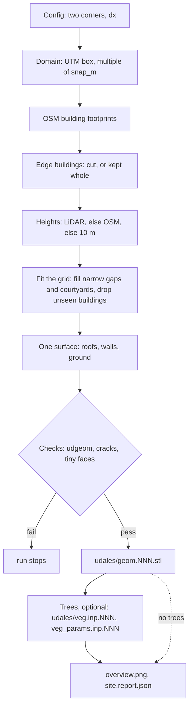

# uDALES-Geo

Pick two corners of an area on OpenStreetMap, write them in a short config
file, run one command — and get the input files for a
[uDALES](https://github.com/uDALES/u-dales) urban LES case: a building STL that
has passed uDALES' own geometry checks and, if you want, trees as uDALES
vegetation files.

This page is the summary for people. Everything in detail — every step,
threshold, check, file and how to change things — is in **[AGENTS.md](AGENTS.md)**.
Where the project stands: [docs/PROGRESS.md](docs/PROGRESS.md).

## What you get

- **Buildings** from OpenStreetMap, with **heights from LiDAR** where it can be
  downloaded automatically (England, the Netherlands, Flanders + Brussels,
  France) and from OSM tags elsewhere.
- **One connected building surface (STL)** — roofs, walls and the ground,
  open only along the domain edge — checked with uDALES' own `udgeom`, and made
  to suit the uDALES grid: gaps and courtyards too narrow for the grid are
  filled, buildings too small for it are dropped, and no faces small enough to
  crash an energy-balance run are left.
- **Periodic domains**: buildings on the domain edge kept whole, and copies
  of the tile when the flow needs a larger domain.
- **Trees** (optional) from LiDAR or a worldwide canopy map, cut around the
  buildings, written as uDALES vegetation files.

## Quick start

All commands run in a terminal inside the `uDALES_Geo` folder (Windows shown;
Linux/macOS: `python3`, `.venv/bin/`, and `/` in paths).

**1. One-time setup** — Python 3.10–3.13 and a clone of the current uDALES
master (the tool uses its `tools/python`).

```bat
python -m venv .venv
.venv\Scripts\pip install -r requirements.txt
setx UDALES_TOOLS "C:\path\to\u-dales\tools\python"
```

(Instead of `UDALES_TOOLS` you can set `"udales_tools"` in the config. Open a
new terminal after `setx`.)

**2. Run the example** (West Village, Manhattan; about a minute plus the
first downloads):

```bat
.venv\Scripts\python -m udales_geo configs\example.jsonc
```

The run ends with `=== example: DONE ===` and a short summary. The files for
your uDALES case are in `sites\example\udales\`; `sites\example\overview.png`
is a picture of the site.

**3. Your own site**

1. `copy configs\example.jsonc configs\my_site.jsonc`
2. In `my_site.jsonc` change `"name"` and `"corners"`. On openstreetmap.org,
   centre the map on one corner: the address bar shows
   `#map=17/51.4975/-0.1795`, which is **latitude first** — the config wants
   **`[longitude, latitude]`**, so `[-0.1795, 51.4975]`. Repeat for the
   opposite corner. The run prints the site centre so you can check it.
3. `.venv\Scripts\python -m udales_geo configs\my_site.jsonc`

Every line of `example.jsonc` is explained in the file; a line you delete takes
its default. Useful switches: `"edge_buildings": "extend"` for periodic cases,
`"vegetation": {"enabled": false}` for buildings only.

**4. Reruns** reuse the downloads, so hand edits are kept (a hand-placed tree
whose centre is inside a building stays in `trees.geojson` but is skipped).
Canopy-source and crown-finding settings take effect only with `--redo-trees`, which
rebuilds the trees; `--force-fetch` downloads the buildings again and
rebuilds the trees (both overwrite hand-edited files).

## How it works



1. **Domain** — the corners are projected to their UTM zone; the box is enlarged
   (never shrunk) to a multiple of `snap_m` — set it to `dx` (or n × `dx`) so
   the domain is whole grid cells.
2. **Buildings** — footprints and height tags from OpenStreetMap.
3. **Edge buildings** — cut at the domain edge, or (`"extend"`, for periodic
   domains) kept whole with the domain grown to fit.
4. **Heights** — LiDAR where available; else the OSM height; else 10 m.
5. **Fit the grid** — uDALES only sees which grid-cell centres lie inside
   buildings. So the tool fills gaps narrower than one cell (their walls would
   get no heat or momentum exchange), fills courtyards the grid would see as
   enclosed shafts too narrow to be stable (uDALES issue #367), and drops
   buildings no cell centre falls in. Fills go up to the lowest roof of the
   buildings that enclose them.
6. **Mesh** — one connected surface of roofs, walls and ground.
7. **Checks** — uDALES' `udgeom` checks the saved STL; the run also stops on
   faces small enough to crash an energy-balance run and (with gap filling
   on) on hair-thin cracks (1 m² or more of crack walls; less is a warning).
8. **Trees** (optional) — canopy heights → individual crowns → tree solids,
   cut around the buildings → grid cells.
9. **Reports** — a picture and `site.report.json` with the domain, the grid
   and everything that was filled or dropped.

## Using the output in uDALES

1. Make sure the run ended with `=== <name>: DONE ===` (if it stopped, the
   files in `udales/` may be from an earlier run).
2. Copy the contents of `udales/` into a uDALES case folder and set
   `stl_file = 'geom.<expnr>.stl'` in `&INPS`. The tool does not write
   `namoptions` or the other inputs — start from an existing case.
3. Use the whole grid from `site.report.json`: `itot`, `jtot`, `ktot`,
   `xlen`, `ylen` in `&DOMAIN` and `zsize` in `&INPS` — keep none of the
   starter case's values (uDALES sets dx = xlen/itot, dy = ylen/jtot, dz =
   zsize/ktot; the report's `dx`, `dy`, `dz` are these). The tree cells were
   computed on this grid, and the courtyard filling was tested on it. To
   change `dx`, `dz` or `zsize`, change the config and rerun.
4. **Trees**: copy the `&TREES` block from `namoptions.trees.<expnr>` into
   `namoptions.<expnr>`.
   - With `ltrees` on, `write_inputs.sh` always runs udprep's tree step: set
     `treesfile = 'trees.<expnr>.stl'` in `&INPS` (without a trees source
     udprep stops), and know that it rewrites `veg.inp` / `veg_params.inp`.
   - Drag-only trees (`itree_mode = 1`): after `write_inputs.sh`, copy our
     `veg.inp.<expnr>` and `veg_params.inp.<expnr>` from `udales/` over
     udprep's (ours keep per-tree ids, drop cells inside buildings and, with
     `voxel_method "exact"`, do not widen the crowns).
   - Trees in an **energy-balance run** (`itree_mode = 2`): let udprep make the
     tree cells from `trees.<expnr>.stl` (`treesfile` in `&INPS`) and **do not
     copy our veg files over them** — udprep also writes `sveg.inp`, which must
     stay row for row in line with its `veg.inp`. The tree energy balance only
     runs with `lmoist` and `ltempeq` on. The tree solids in that STL are cut
     around the buildings; udprep still makes each crown about one cell wider
     and has no building filter, so a few of its cells next to walls lie
     inside buildings (they do not change the flow, the velocity there being
     zero, but they get radiation rows and count in the tree statistics).
5. **After `write_inputs.sh`** on the HPC, check what the uDALES grid really
   looks like:

   ```bash
   python -m udales_geo.case_check <case_folder>
   ```

   It reports narrow enclosed cavities (must be 0), unused facets and missing
   flux. It needs only numpy and scipy, so you can also copy
   `udales_geo/case_check.py` to the HPC and run it on its own.
6. **Core counts**: uDALES needs `nprocx` to divide `itot`, and `nprocy` to
   divide `jtot` and `ktot`. With `snap_m` = n × dx, `itot` and `jtot` are
   multiples of n; with `zsize` a multiple of n × dz, so is `ktot`.
7. **Energy-balance runs**: set `nfaclyrs` explicitly, `lvfsparse = .true.`,
   and `bldT`, `flrT`, `skyLW` (they default to 0). All facets get type 1
   (one material) unless you supply a facet-types file; a starting point is
   `python -m udales_geo.facet_types` (see AGENTS.md — not yet part of the
   normal run).

## Main options in brief

- **Building heights** (`height_source`): `"auto"` (LiDAR where available),
  `"lidar"` (stop without LiDAR) or `"osm"`. Elsewhere you can give your own
  `dsm_file` + `dtm_file`. A footprint LiDAR sees as flat keeps an OSM height
  only; without one it is left out. In South Kensington, LiDAR is a median
  3.8 m taller than OSM where both exist.
- **Periodic domains** (`"edge_buildings": "extend"`): an edge building is kept
  whole if at least half of it lies in your box, otherwise removed whole; the
  domain grows to fit with one cell of open ground at each edge.
- **Copies of the tile** (`"tile": [2, 1]`): the finished periodic tile is
  repeated nx × ny times (buildings only, after the heights): the same
  morphology in a domain large enough for the flow (convective rolls span
  kilometres). The grid and `site.report.json` describe the tiled domain.
- **Grid fitting** (`fill_gaps`, `gap_fill_width_dx`, `fill_courtyards`,
  `courtyard_min_cells`, `drop_unseen_buildings` — all on by default): see
  "How it works", step 5. The fills are in `gap_fills.geojson` and
  `courtyard_fills.geojson` for checking in QGIS.
- **Trees** (`vegetation.source`): `"auto"` = LiDAR if available, else
  `"global"` (Meta/WRI canopy maps, worldwide); `"file"` = your own
  `trees.geojson`. Shapes: `"box"` (default), `"hexagon"`, `"circle"`. Every
  crown is cut around the buildings and fills it would enter (a crown next
  to a wall keeps its street side; `trees_plan.geojson` shows the outlines),
  and a tree standing on a building is dropped.
  uDALES' own tree conversion widens crowns by about one cell per side; the
  default `voxel_method: "udprep"` matches it, `"exact"` does not.
- **Editing**: open `sites/<name>/buildings_osm.geojson` or `trees.geojson` in
  QGIS (they are in metres, not lon/lat), edit, save, rerun. A `trees_file`
  of your own must be in the site's metric CRS too (printed in the
  `[region]` line). OSM areas tagged `building=no` are not buildings and are
  left out.

## Outputs

In `sites/<name>/` (not tracked by git):

| | files |
|---|---|
| **for uDALES** | `udales/geom.<expnr>.stl`; with trees `veg.inp.<expnr>`, `veg_params.inp.<expnr>`, `namoptions.trees.<expnr>`, `trees.<expnr>.stl` |
| **to look at** | `overview.png`, `site.report.json`, `buildings.report.json`, `gap_fills.geojson`, `courtyard_fills.geojson`, `trees_plan.geojson`, `ndsm.tif`, `chm.tif` |
| **to edit** | `buildings_osm.geojson`, `trees.geojson` |
| **bookkeeping** | `buildings_osm.fetch.json`, `*.provenance.json`, `buildings_domain.geojson`, `buildings.footprints.json`, `buildings.stl`, `trees.stl`, `vegetation.report.json`, `*.previous.geojson`, `cache/` |

Every file explained: [AGENTS.md](AGENTS.md).

## Comparison cases

Two ready-made pairs in `configs/`, each differing in one setting:

| configs | site | compares |
|---|---|---|
| `compare_heights_osm` / `compare_heights_lidar` | South Kensington | OSM vs LiDAR building heights |
| `compare_gaps_open` / `compare_gaps_filled` | Earl's Court terraces | narrow gaps left open vs filled |

## Status

Working and checked with real uDALES preprocessing on test sites (October
2026): in South Kensington the uDALES grid has no narrow enclosed cavities, no
unused facets and no missing flux. Open points — facet sizes for energy
balance, facet materials, periodic radiation, grid sizes — are listed in
[docs/PROGRESS.md](docs/PROGRESS.md).

## For developers and agents

Read [AGENTS.md](AGENTS.md): the full pipeline, invariants, how to verify a
change, extension points and known issues. Offline tests:
`.venv\Scripts\python -m pytest tests -q`. Geometry stress test: `python tools/geometry_stress.py`.
Checking a site with uDALES' own preprocessing: [tools/udprep_check](tools/udprep_check/README.md).

## Licence

MIT — see [LICENSE](LICENSE). uDALES itself (GPL-3.0-or-later) is not
included; the tool calls its Python tools at run time. Downloaded data keep their own licences (OpenStreetMap: ODbL; LiDAR and canopy
licences are recorded in the `*.provenance.json` files).
